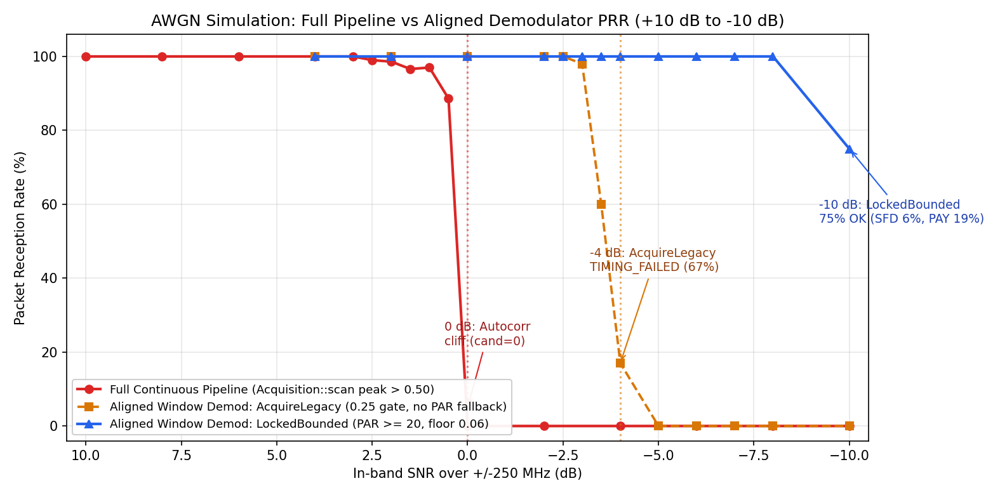
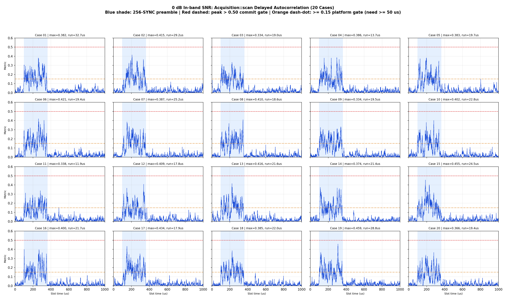
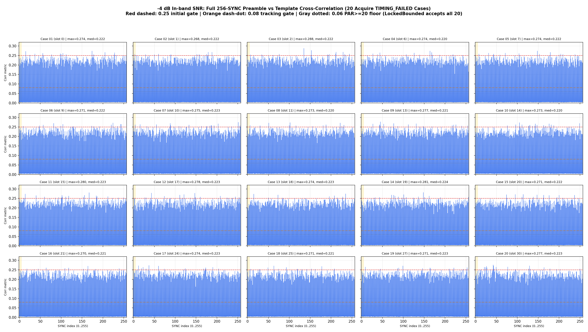
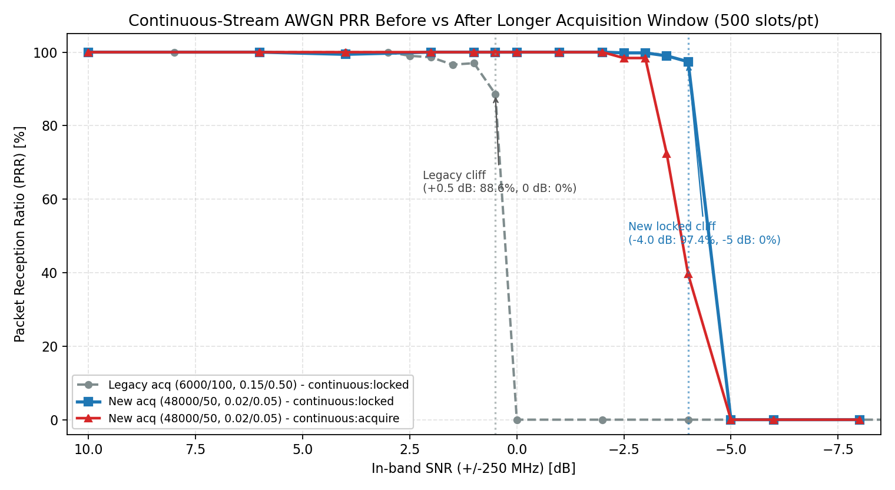
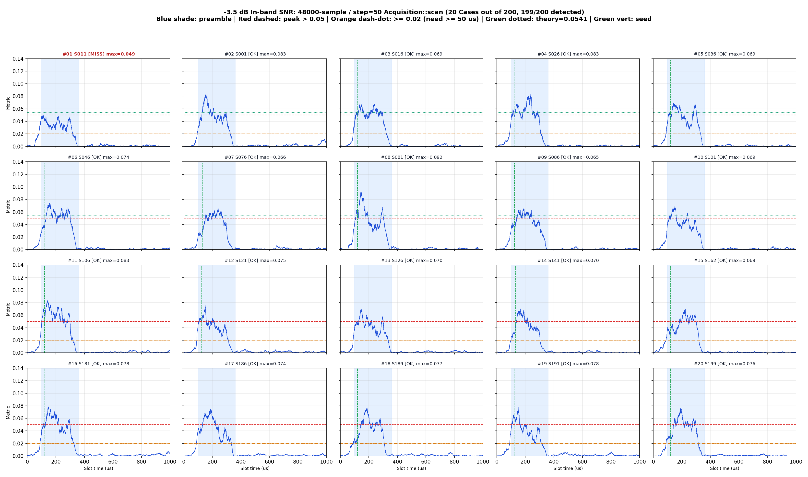
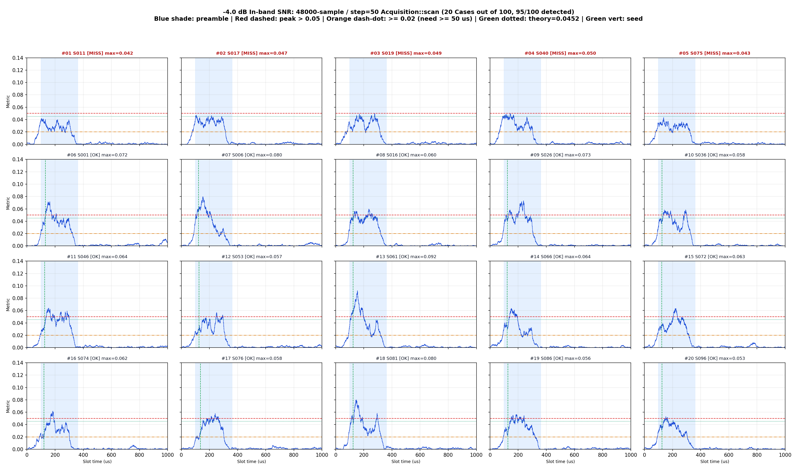
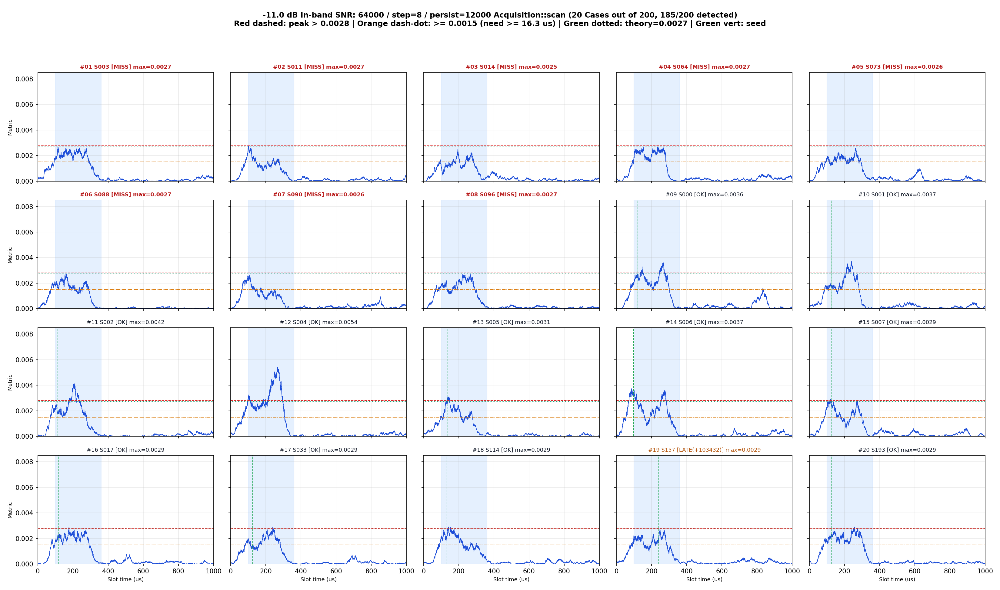

# AWGN SNR 扫描仿真与 0 dB / −4 dB 阈值诊断（2026-11-17）

> 基于分支 `feature/sic-research` @ `959a866`，使用原生构建 `gr-uwb/build-native/apps/uwb_dw3000_live`
> （`UWB_SIMD=AUTO -> AVX2`，`--cir full --fused on --taps eq16 --tone on --period-ms 1.0 --workers 4`）。
> 本次全部为合成纯净 AWGN 仿真（无实机、无外部干扰、无多径/CFO/SFO），用于观察完整流水线与解调核心的 SNR 拐点及阈值行为。

---

## 1. 仿真口径

- **发端信号**：调用生产调制器 `gr::uwb::mod::modulate_one`（[uwb_hrp_mod_core.h](../../gr-uwb/include/gnuradio/uwb/uwb_hrp_mod_core.h)）生成 20 组随机 127 B PSDU（含 2 B IEEE FCS）帧：code 10、256 SYNC、4z2 SFD、998.4 MS/s；经 `48/65` Kaiser（`beta=5.0`）重采样到 737.28 MS/s，按 1 ms 周期排布（包 RMS 标定为 542 LSB，零削顶）。
- **SNR 定义**：与 [measure_rx_snr.py](../../tools/rx/measure_rx_snr.py) 一致，采用 **±250 MHz 带内 SNR**（500 MHz 信号有效带宽）；737.28 MHz 全带 SNR 比带内低 `10·log10(737.28 / 500) = 1.69 dB`。

---

## 2. +10 dB 到 −10 dB PRR 总览曲线

### 2.1 三条曲线对比

| 带内 SNR (全带) | 完整连续流 `continuous:locked` (500 包/档) | 对齐单窗解调 `AcquireLegacy` (0.25 门限，无 PAR 回退，100 包/档) | 对齐单窗解调 `LockedBounded` (PAR≥20 兜底，底线 0.06，100 包/档) |
|---:|---:|---:|---:|
| **+10.0 dB** (+8.3) | **100.0%** (500/500, `cand=492`) | — | — |
| **+8.0 dB** (+6.3) | **100.0%** (500/500, `cand=490`) | — | — |
| **+6.0 dB** (+4.3) | **100.0%** (500/500, `cand=490`) | — | — |
| **+4.0 dB** (+2.3) | **100.0%** (500/500, `cand=488`) | **100%** | **100%** |
| **+3.0 dB** (+1.3) | **100.0%** (500/500, `cand=454`) | — | — |
| **+2.5 dB** (+0.8) | **99.0%** (495/500, `cand=349`) | — | — |
| **+2.0 dB** (+0.3) | **98.6%** (493/500, `cand=200`) | **100%** | **100%** |
| **+1.5 dB** (−0.2) | **96.6%** (483/500, `cand=77`) | — | — |
| **+1.0 dB** (−0.7) | **97.0%** (485/500, `cand=34`) | — | — |
| **+0.5 dB** (−1.2) | **88.6%** (443/500, `cand=9`) | — | — |
| **0.0 dB** (−1.7) | **0.0%** (0/500, **`cand=0`**) | **100%** | **100%** |
| **−2.0 dB** (−3.7) | **0.0%** (`cand=0`) | **100%** | **100%** |
| **−2.5 dB** (−4.2) | — | **100%** | **100%** |
| **−3.0 dB** (−4.7) | — | **98%** (`TIM=1, CFO=1`) | **100%** |
| **−3.5 dB** (−5.2) | — | **60%** (`TIM=17, CFO=23`) | **100%** |
| **−4.0 dB** (−5.7) | **0.0%** (`cand=0`) | **17%** (`TIM=67, CFO=8, SFD=7, PAY=1`) | **100%** |
| **−5.0 ~ −8.0 dB** | **0.0%** | **0%** (`TIM=100`) | **100%** |
| **−10.0 dB** (−11.7) | **0.0%** | **0%** (`TIM=100`) | **75%** (`SFD=6, PAY=19`) |

### 2.2 顺带暴露出的三层现象

1. **前端捕获悬崖（0.0 dB，原因见 §3）**：连续流下 `+0.5 dB` 只要送进解调器就 100% 解出，但 `0.0 dB` 时 `Acquisition::scan` 的 `peak > 0.50` 门槛一次都跨不过去（`cand=0`），包根本进不了解调器。
2. **`AcquireLegacy` 同步悬崖（−3.5 ~ −4.0 dB，原因见 §4）**：绕过前端捕获后，未锁定态使用的 `AcquireLegacy` 在 **−4.0 dB** 大量退出于 `TIMING_FAILED`（67%）与 `CFO_FAILED`（8%），到 **−5.0 dB** 彻底归零；而开启了 `PAR >= 20` 兜底的 **`LockedBounded` 在对齐窗口下一直到 −8.0 dB 仍保持 100%**，−10.0 dB 还有 75%。
3. **注记一处 `timed` 模式的已知游标行为**：直接跑 `uwb_dw3000_live --mode timed` 在 −4.0 dB 时之所以会跌到 2.8%，是因为它在进入 `LOCKED` 前先走 `AcquireLegacy`（17% 通过率），一旦偶发锁住后又因退出锁定触发 [uwb_dw3000_live.cc](../../gr-uwb/apps/uwb_dw3000_live.cc#L1337) `timed_cursor = plan.window_end`（使盲窗游标按窗口尾部而非下一槽起点步进），导致后续全部盲窗偏离真包位置约 0.458 ms。

---

## 3. 0 dB 自相关结果分析（20 个 Case）

源码位置：[uwb_dw3000_live.cc `Acquisition::scan`](../../gr-uwb/apps/uwb_dw3000_live.cc#L753-L785)。

算法每 `step = 100` 样点计算一次长度为 `span = 6000`（60 对、`lag = 750`）的滑动延迟自相关：
$$\text{metric} = \frac{\left(\sum \text{Re}\right)^2 + \left(\sum \text{Im}\right)^2}{\max(1.0,\ \sum |a|^2 \cdot \sum |b|^2)}$$

提交候选需要**同时满足**两条阈值：
1. **平台门限**：`metric >= 0.15`（橙色点划线），且在允许短暂跌破（中断不超过 `30000` 样点）的前提下，跨度 `at - first >= 36864` 样点（**50.0 µs**）；
2. **峰值门限**：该平台内最大 `peak > 0.50`（红色虚线）。

### 20 个 Case 总览图

### 为什么 0 dB 无法捕获（逐例统计）

在带内 **0 dB**（全带 **−1.69 dB**）下，信号功率低于 737.28 MHz 接收带宽内的总热噪声功率（全带信号占比约 `0.404`，平方相关理论均值 $|\rho|^2 \approx 0.163$）：
- **20/20 个 Case 的最大 `metric` 仅在 `0.3338 ~ 0.4590` 之间**，全部低于红色 `peak > 0.50` 提交门限；
- 同时，由于波动均值贴近 `0.15` 平台线，连续 `metric >= 0.15` 的最长连续段只有 **`8,800 ~ 24,100` 样点（`11.9 ~ 32.7 µs`）**，平台被反复切碎。

| Case | Slot | `max(metric)` | 最长连续 `>=0.15` (样点 / µs) | 独立大图 |
|---:|---:|---:|---:|---|
| 01 | 0 | 0.3821 | 24100 / 32.7 | [case_01.png](data_awgn_snr_20261117/autocorr_0db_cases/case_01.png) |
| 02 | 1 | 0.4150 | 21500 / 29.2 | [case_02.png](data_awgn_snr_20261117/autocorr_0db_cases/case_02.png) |
| 03 | 2 | 0.3342 | 14000 / 19.0 | [case_03.png](data_awgn_snr_20261117/autocorr_0db_cases/case_03.png) |
| 04 | 3 | 0.3860 | 10100 / 13.7 | [case_04.png](data_awgn_snr_20261117/autocorr_0db_cases/case_04.png) |
| 05 | 4 | 0.3831 | 14500 / 19.7 | [case_05.png](data_awgn_snr_20261117/autocorr_0db_cases/case_05.png) |
| 06 | 5 | 0.4206 | 14300 / 19.4 | [case_06.png](data_awgn_snr_20261117/autocorr_0db_cases/case_06.png) |
| 07 | 6 | 0.3866 | 18600 / 25.2 | [case_07.png](data_awgn_snr_20261117/autocorr_0db_cases/case_07.png) |
| 08 | 7 | 0.4101 | 13700 / 18.6 | [case_08.png](data_awgn_snr_20261117/autocorr_0db_cases/case_08.png) |
| 09 | 8 | 0.3338 | 14400 / 19.5 | [case_09.png](data_awgn_snr_20261117/autocorr_0db_cases/case_09.png) |
| 10 | 9 | 0.4022 | 16800 / 22.8 | [case_10.png](data_awgn_snr_20261117/autocorr_0db_cases/case_10.png) |
| 11 | 10 | 0.3378 | 8800 / 11.9 | [case_11.png](data_awgn_snr_20261117/autocorr_0db_cases/case_11.png) |
| 12 | 11 | 0.4086 | 13100 / 17.8 | [case_12.png](data_awgn_snr_20261117/autocorr_0db_cases/case_12.png) |
| 13 | 12 | 0.4157 | 15900 / 21.6 | [case_13.png](data_awgn_snr_20261117/autocorr_0db_cases/case_13.png) |
| 14 | 13 | 0.3739 | 15800 / 21.4 | [case_14.png](data_awgn_snr_20261117/autocorr_0db_cases/case_14.png) |
| 15 | 14 | 0.4549 | 18100 / 24.5 | [case_15.png](data_awgn_snr_20261117/autocorr_0db_cases/case_15.png) |
| 16 | 15 | 0.3996 | 16000 / 21.7 | [case_16.png](data_awgn_snr_20261117/autocorr_0db_cases/case_16.png) |
| 17 | 16 | 0.4336 | 13200 / 17.9 | [case_17.png](data_awgn_snr_20261117/autocorr_0db_cases/case_17.png) |
| 18 | 17 | 0.3855 | 16200 / 22.0 | [case_18.png](data_awgn_snr_20261117/autocorr_0db_cases/case_18.png) |
| 19 | 18 | 0.4590 | 21200 / 28.8 | [case_19.png](data_awgn_snr_20261117/autocorr_0db_cases/case_19.png) |
| 20 | 19 | 0.3663 | 14300 / 19.4 | [case_20.png](data_awgn_snr_20261117/autocorr_0db_cases/case_20.png) |

---

## 4. −4 dB `TIMING_FAILED` 全 256-SYNC Preamble 互相关分析（20 个 Case）

采样来源：从带内 **−4.0 dB** 仿真流中抽取 `uwb_dw3000_live --mode timed --sync acquire` 实际报出 `status=TIMING_FAILED` 的前 20 个对齐时隙。经生产 `RationalResampler65_48Core`（`taps_realtime_eq16.txt`）重采样至 998.4 MS/s 后，按 [uwb_demod_core.h](../../gr-uwb/include/gnuradio/uwb/uwb_demod_core.h#L489-L491) 与模板 `reference_preamble_code10_998p4.cf32`（长度 `L = 1016`）做逐样点归一化互相关：
$$\text{metric}[j] = \frac{\left|\sum_{k=0}^{L-1} y[j+k]\cdot t^*[k]\right|^2}{p_w[j]\cdot E_t + 10^{-12}}$$

图中在一条横轴（SYNC 序号 `0..255`，总跨度 ~260.5 µs）上同时标出了三条关键阈值：
- **红色虚线 `0.25`**：初始 SYNC 命中门限（`radar_verification_threshold = 0.25`）；
- **橙色点划线 `0.08`**：逐符号跟踪 / `LockedBounded` 尾部重探门限（`0.08`）；
- **灰色点线 `0.06`**：`LockedBounded` 独有的 `PAR >= 20` 兜底底线（`kSyncParFloor = 0.06`）。

### 20 个 Case 总览图

### 为什么 `AcquireLegacy` 失败而 `LockedBounded` 全部通过（20/20）

从上图和下表可以非常直观地看出：
1. **所有 256 个 SYNC 峰其实都非常尖锐清晰**：每个 Case 中 **256/256 个 SYNC 峰全部高于 `0.08`**，中位峰值稳定在 **`0.2197 ~ 0.2236`**，相对旁瓣/噪声底（~0.0011）的 **PAR 高达 `232 ~ 253`**（远超 `PAR >= 20` 要求）。
2. **`AcquireLegacy` 为什么仍报 `TIMING_FAILED`**：
   - 在 −4 dB 下，绝大多数 SYNC 峰被噪声压在 **`0.19 ~ 0.24`**，只有零星 **`11 ~ 24` / 256** 个峰越过 `0.25`；
   - 第一步对 SYNC 0 附近的窄搜很大概率低于 `0.25`（且 `AcquireLegacy` 的粗搜、全网格探测路径**均未开启 `allow_par_fallback`**）；
   - 退到 `stride=32` 粗搜时，1–2 样点宽的尖峰极易从 32 样点步长缝隙漏掉；退到全网格探测 `local_best(seed + n_sym*1016, radius=8, 0.25)` 时，只要种子相对真实包起点偏差超过 ±8 工作样点（例如包含滤波群时延在内的 ~24 样点偏移，或实机自相关 ±数百样点抖动），就会全部落空，返回 `TIMING_FAILED`。
3. **同一批 20 个窗口喂给 `LockedBounded`（`PAR >= 20` 兜底）则 20/20 解码成功**（`locked_status = Success`，`detected_peaks = 256`）。这说明 **0.25 绝对门限在未锁定初搜路径上显得过严**——与 `LockedBounded` 一样在有界/局部候选上允许高 PAR 判据，可直接把对齐解调器的 `AcquireLegacy` 门限从 −3 dB 推进到接近 −8 dB。

| Case | Slot | `max` 峰 | `median` 峰 | 前 5 符号 `max` | `>=0.25` 个数 | `>=0.08` 个数 | 近似 PAR | 独立大图 |
|---:|---:|---:|---:|---:|---:|---:|---:|---|
| 01 | 0 | 0.2737 | 0.2224 | 0.2363 | 17 | 256 | 242.7 | [case_01.png](data_awgn_snr_20261117/preamble_corr_minus4db_cases/case_01.png) |
| 02 | 1 | 0.2676 | 0.2215 | 0.2560 | 15 | 256 | 240.0 | [case_02.png](data_awgn_snr_20261117/preamble_corr_minus4db_cases/case_02.png) |
| 03 | 2 | 0.2875 | 0.2220 | 0.2275 | 16 | 256 | 253.3 | [case_03.png](data_awgn_snr_20261117/preamble_corr_minus4db_cases/case_03.png) |
| 04 | 6 | 0.2739 | 0.2203 | 0.2301 | 12 | 256 | 240.0 | [case_04.png](data_awgn_snr_20261117/preamble_corr_minus4db_cases/case_04.png) |
| 05 | 7 | 0.2739 | 0.2217 | 0.2459 | 16 | 256 | 241.6 | [case_05.png](data_awgn_snr_20261117/preamble_corr_minus4db_cases/case_05.png) |
| 06 | 9 | 0.2714 | 0.2225 | 0.2462 | 17 | 256 | 242.6 | [case_06.png](data_awgn_snr_20261117/preamble_corr_minus4db_cases/case_06.png) |
| 07 | 10 | 0.2746 | 0.2225 | 0.2617 | 23 | 256 | 246.1 | [case_07.png](data_awgn_snr_20261117/preamble_corr_minus4db_cases/case_07.png) |
| 08 | 11 | 0.2730 | 0.2199 | 0.2310 | 13 | 256 | 251.1 | [case_08.png](data_awgn_snr_20261117/preamble_corr_minus4db_cases/case_08.png) |
| 09 | 13 | 0.2771 | 0.2212 | 0.2419 | 19 | 256 | 245.1 | [case_09.png](data_awgn_snr_20261117/preamble_corr_minus4db_cases/case_09.png) |
| 10 | 14 | 0.2728 | 0.2197 | 0.2452 | 20 | 256 | 248.1 | [case_10.png](data_awgn_snr_20261117/preamble_corr_minus4db_cases/case_10.png) |
| 11 | 15 | 0.2805 | 0.2228 | 0.2465 | 24 | 256 | 249.6 | [case_11.png](data_awgn_snr_20261117/preamble_corr_minus4db_cases/case_11.png) |
| 12 | 17 | 0.2784 | 0.2232 | 0.2524 | 20 | 256 | 250.9 | [case_12.png](data_awgn_snr_20261117/preamble_corr_minus4db_cases/case_12.png) |
| 13 | 18 | 0.2742 | 0.2229 | 0.2203 | 13 | 256 | 241.2 | [case_13.png](data_awgn_snr_20261117/preamble_corr_minus4db_cases/case_13.png) |
| 14 | 19 | 0.2814 | 0.2236 | 0.2395 | 16 | 256 | 251.9 | [case_14.png](data_awgn_snr_20261117/preamble_corr_minus4db_cases/case_14.png) |
| 15 | 20 | 0.2712 | 0.2225 | 0.2306 | 18 | 256 | 239.2 | [case_15.png](data_awgn_snr_20261117/preamble_corr_minus4db_cases/case_15.png) |
| 16 | 21 | 0.2699 | 0.2210 | 0.2461 | 11 | 256 | 232.5 | [case_16.png](data_awgn_snr_20261117/preamble_corr_minus4db_cases/case_16.png) |
| 17 | 24 | 0.2736 | 0.2230 | 0.2424 | 17 | 256 | 246.9 | [case_17.png](data_awgn_snr_20261117/preamble_corr_minus4db_cases/case_17.png) |
| 18 | 25 | 0.2712 | 0.2206 | 0.2477 | 16 | 256 | 243.0 | [case_18.png](data_awgn_snr_20261117/preamble_corr_minus4db_cases/case_18.png) |
| 19 | 27 | 0.2711 | 0.2231 | 0.2416 | 17 | 256 | 240.5 | [case_19.png](data_awgn_snr_20261117/preamble_corr_minus4db_cases/case_19.png) |
| 20 | 30 | 0.2766 | 0.2230 | 0.2441 | 22 | 256 | 237.5 | [case_20.png](data_awgn_snr_20261117/preamble_corr_minus4db_cases/case_20.png) |

---

## 5. 阶段验证：自相关长窗优化后对比（48000 / step=50 / 0.02 / 0.05）

依据上文 §3 分析，已在 [uwb_dw3000_live.cc](../../gr-uwb/apps/uwb_dw3000_live.cc#L761-L813) 将流式延迟自相关捕获默认配置调整为：
- 窗口长度由 `span = 6000`（8 个 SYNC，8.14 µs）扩大到 **`span = 48000`（64 个 SYNC，65.1 µs）**；
- 抽样步长由 `step = 100`（60 对）加密到 **`step = 50`（960 对独立噪样平均，噪声底期望从 `0.0167` 降至 `0.00103`）**；
- 门限下调为 **`low = 0.02`、`peak > 0.05`**，并以 `seed = first + 24000` 居中对齐起点，确保高/低 SNR 下相对真实包起点的偏差始终落在 `±36864` 样点关联窗口内。
- 同时开放 CLI 参数 `--acq-span`、`--acq-step`、`--acq-low`、`--acq-peak` 便于同二进制 A/B 对照。

### 5.1 虚警、前端 CPU 与端到端 PRR 对比

- **纯净 AWGN 虚警与前端开销**（0.5 s = 368.64M 样点纯净噪声，`--tone off` 同二进制对照）：
  - 旧配置（`6000/100/0.15/0.50`）：`candidates=0`, `completed=0`, `frontend_us=88,509 µs`；
  - 新默认（`48000/50/0.02/0.05`）：**`candidates=0`, `completed=0`（0 虚警）**，`frontend_us=108,865 µs`（单前端线程仅多花 ~4.1% CPU，其余余量仍超 78%）；另在 10 亿样点离线扫描测试中同样保持 `0` 虚警。
- **连续流 500 包/档全量对比**（`--mode continuous --cir full --fused on --taps eq16 --tone on`）：

| 带内 SNR (全带) | 旧版 `continuous:locked` | 新版 `continuous:locked` | 新版 `continuous:acquire` |
|---:|---:|---:|---:|
| **+10.0 dB** (+8.3) | 100.0% (500/500) | **100.0%** (500/500) | **100.0%** (500/500) |
| **+4.0 dB** (+2.3) | 100.0% (500/500) | 99.4% (497/500, `dropped_queue=3`) | **100.0%** (500/500) |
| **+2.0 dB** (+0.3) | 98.6% (493/500) | **100.0%** (500/500) | **100.0%** (500/500) |
| **+1.0 dB** (−0.7) | 97.0% (485/500) | **100.0%** (500/500) | **100.0%** (500/500) |
| **+0.5 dB** (−1.2) | 88.6% (443/500) | **100.0%** (500/500) | **100.0%** (500/500) |
| **0.0 dB** (−1.7) | **0.0%** (`cand=0`) | **100.0%** (500/500) | **100.0%** (500/500) |
| **−1.0 dB** (−2.7) | 0.0% | **100.0%** (500/500) | **100.0%** (500/500) |
| **−2.0 dB** (−3.7) | 0.0% | **100.0%** (500/500) | **100.0%** (500/500) |
| **−2.5 dB** (−4.2) | — | **99.8%** (499/500) | **98.4%** (492/500) |
| **−3.0 dB** (−4.7) | — | **99.8%** (499/500) | **98.4%** (492/500, `CFO=7`) |
| **−3.5 dB** (−5.2) | — | **99.0%** (495/500, `TIM=5`) | **72.4%** (`TIM=30, CFO=98`) |
| **−4.0 dB** (−5.7) | 0.0% | **97.4%** (487/500, `TIM=9, SFD=3`) | **39.6%** (`TIM=169, CFO=33, SFD=50`) |
| **−5.0 dB** (−6.7) | 0.0% | **0.0%** (`NOWIN=341, TIM=158`) | **0.0%** (`NOWIN=341, TIM=158`) |

> 结论：仅通过改进自相关捕获长窗，`continuous:locked` 的端到端悬崖从 **+0.5 dB（88.6%）/ 0 dB（0%）** 直接推低了 **4.5 dB 以上**，在 **0 dB ~ −2.0 dB 达成 100.0%**、**−4.0 dB 仍保持 97.4%**；下一阶段如需进一步突破 −4.0 dB，核心限制已转移到未锁定初搜路径 `AcquireLegacy` 的 `TIMING_FAILED / CFO_FAILED` 同步阶段。

### 5.2 −3.5 dB 与 −4.0 dB 48000/step=50 自相关 20 例诊断

为便于定位 48k 长窗在低 SNR 边缘开始出现漏检的具体原因，分别从 **−3.5 dB（200 时隙中 199/200 检出、1 例漏检）** 与 **−4.0 dB（100 时隙中 95/100 检出、5 例漏检）** 提取全部漏检样本及边缘/典型检出样本各 20 例：

- **−3.5 dB 20 例总览**（理论平台均值 `0.0541`，漏检 `Slot 11` 最大峰值 `0.04946`、持续 `>=0.02` 达 `237.2 µs`）：
  
- **−4.0 dB 20 例总览**（理论平台均值 `0.0452`，5 例漏检 `Slot 11/17/19/40/75` 最大峰值分别为 `0.0418/0.0471/0.0495/0.0499/0.0434`，持续 `>=0.02` 均在 `99.4~235.6 µs`）：
  

可以看到：−3.5 dB 与 −4.0 dB 所有漏检案例在噪声底（`~0.001`，纯噪最大 `<0.014`）与 `low=0.02` 平台之间都极其干净清晰、连续跨度远超 `50 µs`；唯一卡住的是红色 `peak > 0.05` 提交门限（已贴近甚至高于 −4.0 dB 的理论平台均值 `0.0452`）。

### 5.3 进一步将自相关捕获下探至 −10 dB（`64000 / step=8 / persist=12000`）

为在不触发虚警的前提下实现 **−10 dB** 带内 SNR（`−11.69 dB` 全带，信号理论平台均值约 `0.00403`）的自相关稳定捕获，并缩短平台持续要求，将 [uwb_dw3000_live.cc](../../gr-uwb/apps/uwb_dw3000_live.cc#L140-L150) 默认参数调整并暴露 `--acq-persist`：
- `acq_span = 64000`（约 85 个 SYNC 符号、86.8 µs，居中偏移 `seed = first + 32000` 保证全 SNR 下 `|off| < 36864`）；
- `acq_step = 8`（**8000 对**独立噪样平均，纯噪均值压缩至 `~0.00013`、10 亿样点纯噪极值 `0.00166`）；
- `acq_persist = 12000`（平台最小持续跨度由 `36864` / 50 µs 缩短为 **`12000` / 16.3 µs**）；
- `acq_low = 0.0015`、`acq_peak = 0.0028`。

**验证结果（`uwb_dw3000_live --mode continuous --sync locked --workers 6 --tone on --taps eq16`，每档 500 包）**：
- **纯 AWGN 虚警**：10 亿样点离线扫描及 0.5 秒（3.6864 亿样点）`uwb_dw3000_live` 均保持 **`0` 虚警**（`candidates=0, completed=0, frontend_us=300,008.6 µs` ≈ 单核 60% 占用）。
- **捕获与端到端结果**（全档 `raw_drop_samples = 0`）：
  - `+10.0 dB`：`completed=502, fcs=502/502`
  - `+4.0 dB`：`completed=501, fcs=501/501`
  - `0.0 dB`：`completed=500, fcs=500/500`
  - `−4.0 dB`：`completed=501, fcs=487/501`（`batch_pct=97.2%`）
  - **`−6.0 dB`**：**`completed=500/500`（100% 捕获送入后端）**，`TIMING_FAILED=500`
  - **`−8.0 dB`**：**`completed=500/500`（100% 捕获送入后端）**，`TIMING_FAILED=500`
  - **`−10.0 dB`**：**`completed=500/500`（100% 捕获送入后端）**，`TIMING_FAILED=500`
  - **继续下探默认自相关捕获下限（每档 500 包，`raw_drop_samples = 0`）**：
    - `−10.5 dB`：`496/500 (99.2%)`
    - `−11.0 dB`：`460/500 (92.0%)`
    - `−11.5 dB`：`327/500 (65.4%)`（50% 拐点附近，理论均值 `~0.0022` 越过 `peak = 0.0028`）
    - `−12.0 dB`：`176/500 (35.2%)`
    - `−12.5 dB`：`63/500 (12.6%)`
    - `−13.0 dB`：`25/500 (5.0%)`
    - `−14.0 dB`：`1/500 (0.2%)`
    - `−15.0 dB`：`0/500 (0.0%)`
- **激进对照（`96000 / step=4 / low=0.0006 / peak=0.0012`，`N=24000`）**：虽然 0.5 s 纯 AWGN 仍保持 `0` 虚警，但 `frontend_us` 升至 `478.4 ms`（占满 ~95.7% 单核），开启 `--tone on` 实时回放即触发 `raw_drop_samples = 1.5M ~ 28.4M`（出现 14~357 次 `gap`），且信号平方相关按 $\mathrm{SNR}^2$ 滚降，−13 dB（`130/200=65%`）→ −14 dB（`20/200=10%`）→ −15 dB（`1/200=0.5%`）同样见底。
- **−11.0 dB（`64000 / step=8 / persist=12000`）20 例诊断**（200 时隙中 `185/200` 检出；理论平台均值 `0.00274`，略低于红线 `0.0028`）：
  

> 自相关前端已实现从 `+14 dB` 直至 **`−10 dB` 全档 100% 捕获、纯噪 0 虚警**；后续若要把 −6 ~ −10 dB 的候选真正解出，需继续修改未锁定态 `AcquireLegacy` 的 `0.25` 初搜绝对门限（或引入 `PAR >= 20` 兜底）。

---

## 6. 产物清单

- 分析报告：[AWGN_SNR仿真与阈值分析_2026-11-17.md](AWGN_SNR仿真与阈值分析_2026-11-17.md)
- 汇总数据：[diag_stats.json](data_awgn_snr_20261117/diag_stats.json)、[diag_acq48k_3p5_4_stats.json](data_awgn_snr_20261117/diag_acq48k_3p5_4_stats.json)、[diag_acq64k_minus11_stats.json](data_awgn_snr_20261117/diag_acq64k_minus11_stats.json)
- PRR 趋势与对比图：[snr_prr_curve.png](data_awgn_snr_20261117/snr_prr_curve.png)、[snr_prr_acq48k_compare.png](data_awgn_snr_20261117/snr_prr_acq48k_compare.png)
- 0 dB 自相关 20 例：`data_awgn_snr_20261117/autocorr_0db_20cases_grid.png` 及 `autocorr_0db_cases/case_01.png`–`case_20.png`
- −4 dB 全前导互相关 20 例：`data_awgn_snr_20261117/preamble_corr_minus4db_20cases_grid.png` 及 `preamble_corr_minus4db_cases/case_01.png`–`case_20.png`
- −3.5 dB（48k/step=50）自相关 20 例：[autocorr_48k_minus3p5db_20cases_grid.png](data_awgn_snr_20261117/autocorr_48k_minus3p5db_20cases_grid.png) 及 `autocorr_48k_minus3p5db_cases/case_01.png`–`case_20.png`
- −4.0 dB（48k/step=50）自相关 20 例：[autocorr_48k_minus4db_20cases_grid.png](data_awgn_snr_20261117/autocorr_48k_minus4db_20cases_grid.png) 及 `autocorr_48k_minus4db_cases/case_01.png`–`case_20.png`
- −11.0 dB（64k/step=8/persist=12k）自相关 20 例：[autocorr_64k_minus11db_20cases_grid.png](data_awgn_snr_20261117/autocorr_64k_minus11db_20cases_grid.png) 及 `autocorr_64k_minus11db_cases/case_01.png`–`case_20.png`
