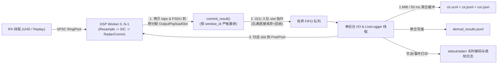

# 纯 C++ Pipeline CIR / 解码落盘与实时日志开发规划

> [!IMPORTANT]
> 本规划完全基于当前工作树 `.worktrees/sensing-shared-cir`（分支 `feature/sensing-shared-cir`，`HEAD = a5d2a9e`），**不引入任何 GNU Radio 模块（不依赖 `gnuradio-runtime`、`gr::block` 或 `pmt`）**，同时在磁盘格式上复用既有 `UwbCirWriter`（`.ucr4` + `cir.jsonl` + `run.json`）与 `demod_results.jsonl` 契约，并吸收 `origin/perf/writer-aggregate` 的聚合写盘防抖机制。

---

## 1. 核心设计原则与约束

1. **零 GNU Radio / PMT 依赖**
   - 现有 [uwb_cir_writer.h](file:///home/junqima/workspace/uwb-gnuradio/.worktrees/sensing-shared-cir/gr-uwb/include/gnuradio/uwb/uwb_cir_writer.h) 继承自 `gr::block` 并依赖 `pmt::pmt_t`。
   - 新方案将 **UCR4 编解码** 与 **异步写盘/日志线程** 抽离为纯 C++ 组件，仅依赖标准库与纯 C++ core 头文件，可直接编译进 `UhdSc16Pipeline` 与 [uwb_uhd_sc16_pipeline_runner.cc](file:///home/junqima/workspace/uwb-gnuradio/.worktrees/sensing-shared-cir/gr-uwb/apps/uwb_uhd_sc16_pipeline_runner.cc)。

2. **热路径零退化、零动态分配**
   - **未启用落盘与实时日志时**：DSP worker 仅多一次 `if (output_writer_)` 布尔判断；0 内存分配、0 锁竞争、0 时钟读取，保证现有 `a5d2a9e` 基准零回归。
   - **启用落盘或实时日志时**：
     - **禁止阻塞 RX 与 DSP 线程**：磁盘 `write()`、`fsync`/flush、JSON 拼接与终端 `printf/fwrite` 全部下沉到**单个专用后台 I/O & Logger 线程**。
     - **禁止把变长 taps / PSDU 塞进 `WindowResult`**：`UhdSc16Pipeline::results_` 会持续累积整轮运行的 `WindowResult`。若直接内嵌变长数组，长跑 UHD 会线性吃满内存并破坏拷贝开销。改为**预分配固定容量的旁路池槽位（`OutputPayloadSlot`）**，写完立即回收归池。
     - **非阻塞背压免疫**：池满或写队列满时立即丢弃并原子累加 `dropped`，绝不阻塞 UHD RX 或 DSP worker。

3. **多 Worker 严格按 `window_id` 顺序输出**
   - 当 `--dsp-workers > 1`（如 4 或 8）时，不同 worker 完成窗口的顺序可能乱序。
   - 复用 [uwb_uhd_sc16_pipeline.cc](file:///home/junqima/workspace/uwb-gnuradio/.worktrees/sensing-shared-cir/gr-uwb/lib/uwb_uhd_sc16_pipeline.cc#L3356-L3439) 现有的 `commit_result()` 重排机制：在 `commit_mutex_` 内只做 **O(1) 槽位句柄入队** 到后台线程的环形队列（耗时百纳秒级），即可保证 `.ucr4`、`cir.jsonl`、`demod_results.jsonl` 以及终端日志严格按 `window_id` 递增输出。

---

## 2. 总体数据流与线程架构

---

## 3. 复用与扩展的数据格式规范

### 3.1 Sensing CIR 格式（100% 兼容 `UwbCirWriter` 与 MATLAB `read_uwb_cir.m`）

输出目录 `<output_dir>/` 下生成与旧版完全兼容的 3 个文件（支持 `--cir-base` 自定义前缀，默认 `cir`）：

1. **`<cir_base>.ucr4`（小端二进制，仅成功帧追加）**
   - 复用 52 字节 `Ucr4Header`（与 [uwb_cir_writer.h](file:///home/junqima/workspace/uwb-gnuradio/.worktrees/sensing-shared-cir/gr-uwb/include/gnuradio/uwb/uwb_cir_writer.h#L63-L78) 逐字节一致）：
     - `magic = "UCR4"`
     - `pulse_id` (`u32`) ← `window_id`
     - `status` (`u16`) ← `static_cast<uint16_t>(cir_res.status)`（`0=ok, 1=sfd_failed, 2=timing_failed, 3=cir_failed, 4=invalid_input`，与旧版枚举完全一致）
     - `tap_count` (`u16`) ← `cir_res.tap_count`
     - `repetition_index` (`u16`) ← `0xFFFF`（聚合平均帧约定值）
     - `repetition_count` (`u16`) ← `cir_res.valid_repetitions`
     - `sfd_metric` (`f32`), `cir_peak_metric` (`f32` ← `cir_res.peak_abs`), `peak_tap` (`i32`), `estimator_us` (`u32` ← `timing.sensing_us`)
     - `freq_hz` (`f64` ← `cfg_.uhd_center_freq`), `freq_offset_hz` (`f64` ← `cir_res.final_cfo_hz`)
     - `cir_scale` (`f32`) ← 逐帧块浮点 `peak / 32767.0f`
   - 紧随其后为 `tap_count` 个交错 `int16`（I, Q）tap（来源为 `radar_scratch.cir.raw_taps`，真幅度而非归一化 taps；读取端按 `FC32 = SC16 * cir_scale` 还原）。

2. **`<cir_base>.jsonl`（每窗一行 JSON，失败帧亦留痕）**
   - 兼容 [read_uwb_cir.m](file:///home/junqima/workspace/uwb-gnuradio/testdata/uwb_radar/read_uwb_cir.m) 的核心键：`pulse_id`, `schedule_index`, `status`, `sample_rate`, `tap_count`, `cir_pre_samples`, `cir_post_samples`, `file_offset_taps`, `zero_delay_tap`（=`cir_pre`）, `peak_tap`, `cir_peak_metric`, `peak_delay_from_calibration_ns`, `range_m_per_tap`, `raw_l2_norm`, `preamble_start_sample`, `sfd_start_sample`, `cir_origin_sample`, `sfd_ok`, `timing_ok`, `estimator_us`。
   - 额外追加共享/SIC 观测键（不影响旧解析器）：`cfo_hz`, `valid_repetitions`, `native_start_abs`, `sic_executed`, `sic_committed`, `actual_suppression_db`。
   - 失败帧（`status != "ok"` 或 `tap_count == 0`）**不写 `.ucr4`、不推进 `file_offset_taps`**，但在 `.jsonl` 中写一行 `tap_count: 0` 记录，保证故障可观测。

3. **`run.json`（初始化写一次）**
   - 保留 `tap_format: "ucr4"`, `byte_order: "little-endian"`, `header_bytes: 52`, `bytes_per_tap: 4`, `reconstruction: "fc32 = sc16 * cir_scale"`, `range_m_per_tap`，并记录本次流水线参数（`consumer_mode`, `native_rate`, `work_rate`, `uhd_center_freq`, `sic_policy`, `sic_backend`）。

4. **聚合缓冲落盘（来自 `origin/perf/writer-aggregate`）**
   - 后台线程持有预分配 `ucr4_buf_` 与 `jsonl_buf_`（默认 `aggregate_bytes = 1 MiB`、`aggregate_window_ms = 50 ms`，两者任一先达即单次大块写入；设为 `0` 可退回逐帧写入）。
   - `stop()` 时排空队列并将残留聚合缓冲彻底 flush + close。

---

### 3.2 通信解码落盘（`demod_results.jsonl`）

保留与 [uwb_scheduled_dump_io.h](file:///home/junqima/workspace/uwb-gnuradio/.worktrees/sensing-shared-cir/gr-uwb/include/gnuradio/uwb/uwb_scheduled_dump_io.h#L47-L59) 兼容的既有字段，并补齐此前 `ResultTap` 缺失的解码内容与状态：

- **向后兼容基础字段**：
  `packet_id`（=`window_id`）、`schedule_index`、`status`（`"ok"` / `"timing_failed"` / `"sfd_failed"` / `"ns_sfd_failed"` / `"phr_failed"` / `"payload_failed"` / `"fcs_failed"` 等）、`fcs_pass`、`detected_start_sample`（=`comm_sync_origin`）、`predicted_start_sample`、`native_window_start`、`resample_us`、`t_total_us`（=`comm_us`）。
- **新增解码载荷与诊断字段**：
  - `sfd_start_sample`、`cfo_hz`
  - `phr_ok`、`phr_psdu_length`、`phr_rate_mbps`、`phr_corrected`、`phr_uncorrectable`
  - `payload_nbytes`、`fcs_received`、`fcs_calculated`、`psdu_fnv1a`
  - **`psdu_hex`**：解码出的 PSDU 原始字节小写十六进制字符串（无载荷时为 `""`，最高 127 B -> 254 chars）
  - **SIC 关联状态**：`sic_executed`、`sic_committed`、`sic_suppression_db`、`sic_status`
- 同样通过后台线程预分配缓冲聚合写入 `<output_dir>/demod_results.jsonl`（默认每次 `comm_attempted` 写一行，支持选项 `--comm-write-only-ok` 仅保存解码成功/FCS 通过的包）。

---

### 3.3 实时日志输出（`LiveConsoleLogger`）

由同一后台线程输出到 `stdout`（或独立流），默认关闭（`--live-log off`），支持 3 种在线显示模式：

1. **`events`（推荐实时联调模式）**：
   - 仅在发生有效事件或状态变化时打印单行摘要（避免空白周期刷屏）：
     - **Comm**：当检测到包（`comm_sync_origin >= 0` 或 `comm_ok` 或 `fcs_pass`）时打印：
       `[WIN 00042 | sch 42] COMM ok  fcs=PASS len=32B rate=6.81M cfo=+12.4kHz sic=off/28.3dB psdu=418800cafe...`
     - **Sensing**：SFD 检出变化或异常（如从 ok 变为 `sfd_failed`）或按采样步长打印 CIR 峰值位置：
       `[WIN 00042] SENSING ok peak_tap=18 (+2 tap, 2.00 ns) metric=0.914 cfo=+1.2kHz`
     - **AutoSchedule**：状态切换时（`Acquiring -> Locked -> Holdover`）打印锁相摘要。
2. **`all`（全窗口流水线日志）**：
   - 每个窗口一行打印 SIC / Sensing / Comm 三段结果（适合低重复率或离线回放排查）。
3. **`summary`（周期滚动仪表盘，配合 `--live-log-interval-ms`，默认 500 ms）**：
   - 固定周期刷新一行/多行汇总：当前窗口号、窗口速率（win/s）、Sensing SFD 检出率与最近 peak_tap、Comm 检出/FCS 通过率与最新一帧 `psdu_hex`、SIC 触发率与平均抑制比、writer 队列水位与丢包数 `wr_drop`。

---

## 4. 代码改动模块拆解

### 模块 A：纯 C++ UCR4 与异步输出模块（新增，零 GNU Radio 依赖）
- **新增 [uwb_ucr4_format.h](file:///home/junqima/workspace/uwb-gnuradio/.worktrees/sensing-shared-cir/gr-uwb/include/gnuradio/uwb/uwb_ucr4_format.h)**
  - 纯 C++ 声明 `Ucr4Header`（`static_assert(sizeof(Ucr4Header) == 52)`）、`encode_cir_sc16()`、`decode_cir_sc16()`、`cir_status_name()`。
  - 可选让既有 [uwb_cir_writer.h](file:///home/junqima/workspace/uwb-gnuradio/.worktrees/sensing-shared-cir/gr-uwb/include/gnuradio/uwb/uwb_cir_writer.h) 复用该 header（或保持原样不变以确保零回归）。
- **新增 `uwb_pipeline_output_writer.h` / `uwb_pipeline_output_writer.cc`**
  - `OutputPayloadSlot`：预分配 `std::vector<std::complex<float>> cir_taps` + `std::vector<uint8_t> psdu_bytes` + `WindowResult` 精简镜像及 `RadarCirResult`/`DemodResult` 所需字段（`fcs_received`, `fcs_calculated`, `phr_rate_mbps`, `phr_corrected`, `phr_uncorrectable`, `raw_l2_norm`, `sfd_metric`, `cir_pre`, `cir_post`, `native_window_start`, `predicted_start_sample`）。
  - `PipelineOutputWriter`：管理 `free_pool_`（无锁/短锁预分配槽位池）、有界 `write_queue_`、`writer_loop()` 后台线程、1 MiB / 50 ms 聚合缓冲、`run.json` 写出、实时日志格式化输出，以及统计指标 `OutputWriterStats`。

### 模块 B：`UhdSc16Pipeline` 集成
- **修改 [uwb_uhd_sc16_pipeline.h](file:///home/junqima/workspace/uwb-gnuradio/.worktrees/sensing-shared-cir/gr-uwb/include/gnuradio/uwb/uwb_uhd_sc16_pipeline.h)**
  - 在 `PipelineConfig` 新增 `OutputPersistenceConfig output;`（含 `output_dir`, `cir_base_name`, `comm_base_name`, `write_cir`, `write_comm`, `comm_write_only_ok`, `writer_queue_capacity`, `writer_aggregate_bytes`, `writer_aggregate_window_ms`, `live_log_mode`, `live_log_interval_ms`, `live_log_psdu`）。
  - 新增 `OutputWriterStats output_writer_stats() const;` 查询接口。
- **修改 [uwb_uhd_sc16_pipeline.cc](file:///home/junqima/workspace/uwb-gnuradio/.worktrees/sensing-shared-cir/gr-uwb/lib/uwb_uhd_sc16_pipeline.cc)**
  - `initialize()`：仅当 `!cfg_.output.output_dir.empty()` 或 `cfg_.output.live_log_mode != LiveLogMode::Off` 时创建并启动 `PipelineOutputWriter`；预计算每个槽位所需 `max_cir_taps`（来自 `effective_radar_cfg.cir_pre + cir_post`）和 `max_psdu = 127`。
  - DSP Worker 热路径（L3212–L3318 之后）：若 `output_writer_` 启用，尝试从池中获取一个 `OutputPayloadSlot*`，拷贝 `radar_scratch.cir.raw_taps`（前 `tap_count` 个）和 `demod_res.payload.bytes` 及元信息。
  - `commit_result()`：在按 `window_id` 顺序 emit 时，将对应的 `OutputPayloadSlot*` 入队给 `PipelineOutputWriter`（`results_` 中绝不保留大数组），并在 `stop()`/`wait()` 时确保 `output_writer_->stop_and_drain()` 落盘完所有在途帧再返回。

### 模块 C：Runner CLI 与 CMake 接入
- **修改 [gr-uwb/lib/CMakeLists.txt](file:///home/junqima/workspace/uwb-gnuradio/.worktrees/sensing-shared-cir/gr-uwb/lib/CMakeLists.txt)**：加入 `uwb_pipeline_output_writer.cc`（编译选项 `-O3 -march=native`，不引入任何 GR 依赖）。
- **修改 [uwb_uhd_sc16_pipeline_runner.cc](file:///home/junqima/workspace/uwb-gnuradio/.worktrees/sensing-shared-cir/gr-uwb/apps/uwb_uhd_sc16_pipeline_runner.cc)**：
  - 新增 CLI 参数：
    - `--output-dir <dir>`
    - `--cir-base <name>`（默认 `cir`）
    - `--no-cir-write` / `--no-comm-write` / `--comm-write-only-ok`
    - `--writer-queue <n>` / `--writer-agg-bytes <n>` / `--writer-agg-ms <n>`
    - `--live-log <off|events|all|summary>`
    - `--live-log-interval-ms <n>`
    - `--live-log-psdu <0|1>`
  - 在 Run Summary 与 `--json-out` meta 中汇报 `output_writer_stats`（`cir_written`, `comm_written`, `dropped`, `aggregate_flushes`, `bytes_written`）。

---

## 5. 开发分工与实施顺序（可拆给多 Agent 执行）

| 阶段/Track | 负责内容 | 关键验收指标 |
|---|---|---|
| **Track 1** | 纯 C++ `uwb_ucr4_format.h` + `uwb_pipeline_output_writer.h/.cc` 实现（UCR4 / JSONL / `run.json` / `demod_results.jsonl` / 聚合写盘 / `LiveConsoleLogger`） | 单元测试验证 `sizeof(Ucr4Header)==52`、块浮点量化/还原、聚合写盘与逐条写盘字节级一致、失败帧不推进 `file_offset_taps`、慢写注入下 `dropped` 账本守恒 |
| **Track 2** | `UhdSc16Pipeline` 集成（`OutputPayloadSlot` 池、`commit_result` 顺序入队、`stop/wait` drain） | `dsp_workers ∈ {1, 4, 8}` 乱序完成场景下输出文件严格按 `window_id` 升序；关闭开关时与基线功能/性能无差异 |
| **Track 3** | `uwb_uhd_sc16_pipeline_runner.cc` CLI + 端到端/格式兼容 QA | 同时跑 `both` / `sic_plus_comm` / `sensing` / `comm`（含干净包与带干扰包）：验证生成的 `cir.ucr4` + `cir.jsonl` 可被独立 Python/UCR4 解析器无误解析，`demod_results.jsonl` 可被 `uwb_scheduled_dump_io.h` 解析且 `psdu_hex` 与发送测试向量逐字节匹配；全量 CTest 通过 |

---

## 6. 验证清单（Verification Plan）

1. **单元测试（纯 C++ QA：`qa_uwb_pipeline_output_writer.cc`）**
   - 验证 `cir.ucr4` + `cir.jsonl` + `run.json` 格式与既有 `UwbCirWriter` 契约完全一致（含失败帧、`tap_count=0`、`file_offset_taps` 守恒）。
   - 验证 `demod_results.jsonl` 可被 `gr::uwb::core::parse_demod_results_jsonl()` 无误读取，且 `psdu_hex` / `psdu_fnv1a` 自洽。
   - 验证聚合写模式（1 MiB / 50 ms）与逐条写模式（`agg_bytes=0`）产生的 `.ucr4` 与 `.jsonl` 文件字节级一致。
   - 慢磁盘/阻塞注入测试：构造极小队列（`queue_capacity = 4`）+ 写入延迟，验证 DSP/RX 不阻塞、不死锁且 `enqueued + dropped == total_submitted`。
2. **多核顺序性与端到端集成测试**
   - 在 `dsp_workers = 4` 乱序完成条件下，确认 `cir.jsonl` / `cir.ucr4` / `demod_results.jsonl` 的 `pulse_id` / `packet_id` 严格升序且无遗漏/重复。
   - 使用现有混合信号与干净 DW3000/HRP fixture 运行 `--consumer both` 与 `--consumer sic_plus_comm --output-dir ... --live-log events`，核对真实 `psdu_hex`、CIR 峰值和实测抑制比。
   - 运行全量 CTest，确认原有 88 项测试无回归。
