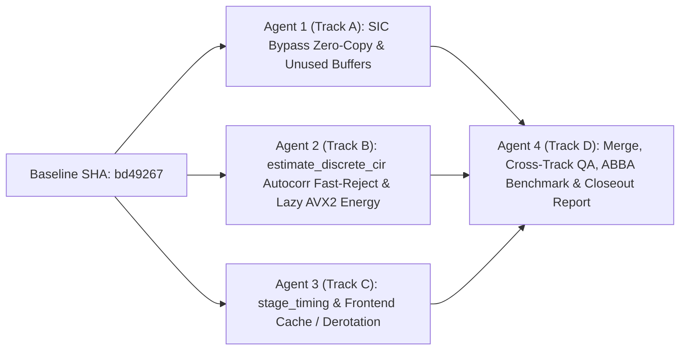

# OpenCode 多 Agent 并行开发方案：单窗端到端（E2E）低垂果实性能优化

**版本基线**：worktree `/home/junqima/workspace/uwb-gnuradio/.worktrees/sensing-shared-cir`，分支 `feature/sensing-shared-cir`，control SHA `bd492670d604696efd3ac8f0ec4105516698b944`（`bd49267`）。  
**默认构建目录**：`gr-uwb/build-sensing-shared-cir-r3`（`UWB_HAVE_UHD=0`，串行 CTest baseline：**88 项，87 通过，1 跳过** `uwb_qa_install_consumer`，0 失败，123.66 s）。  
**任务目标**：针对 737.28M→998.4M (`realtime_eq16`) 单窗端到端流水线实测中已定位的 3 组可工程化"低垂果实"，采用 **3 个文件严格隔离的并行开发 Agent + 1 个集成回归与 ABBA 基准 Agent** 协同实施，在不牺牲感知灵敏度 / 通信误帧率 / SIC 抑制能力与 fail-closed 安全语义的前提下，系统性压降 clean 与 jamming 场景的单窗延迟，并降低 `N=8` 并发下的内存带宽争用。

---

## 1. 基线实测数据（Control `bd49267`，禁止凭记忆外推）

以下为当前已实测基线（`UWB_HAVE_UHD=0`，`realtime_eq16`，64 稳态窗）：

### 1.1 端到端流水线基线（N=1 vs N=8）

| 场景 | `native_n` | N=1 单窗均值 (µs) [拆解] | N=1 steady (µs/窗) | N=8 单窗均值 (µs) | N=8 steady (µs/窗) |
| --- | ---: | --- | ---: | ---: | ---: |
| Clean Mode A (64 SYNC) | 127,572 | `902.7` [resamp `322.5`, sic `390.7`, sens `188.3`] | `909.2` | `1451.0` | `427.1` |
| Clean Mode B (64 SYNC + 32B) | 257,636 | `2029.1` [resamp `655.7`, sic `745.9`, comm `624.2`] | `2037.2` | `3529.1` | `610.6` |
| Clean Mode A (256 SYNC) | 271,626 | `1926.9` [resamp `673.4`, sic `668.7`, sens `582.4` (fe `558.0`, cir `20.7`)] | `1932.5` | `4134.2` | `715.1` |
| Clean Mode B (256 SYNC + 127B) | 401,689 | `3694.8` [resamp `991.3`, sic `1230.5`, comm `1467.2`] | `3707.8` | `8309.5` [resamp `2037.4`, sic `3580.8`, comm `2684.9`] | `1575.2` |

### 1.2 单核微基准与阶段拆解（20 轮 / 孤立基准）

- **`ModeA_256_jam`**（`dsp_n=367,848`, `sic_committed=1`）：
  `sic_total=3338.9 us [est=1243.3 (det=832.7), comm_rx=1080.3, rec=338.8, sub=283.6]`；
  `sensing=953.6 us [fe_t=517.3, fe_cfo=220.8, fe_sfd=211.9]`。
- **`ModeB_256_clean`**（`dsp_n=543,975`, fast RX flags 全开）：
  `comm=1176.2 us [t=451.1, cfo=23.8, sfd=211.7, cir=138.4, phr=21.0, pay=313.2]`；
  `sic_total=938.5 us [est=688.4 (det=293.6)]`。
- **孤立内存/预检微基准**（`n=543,975`）：
  - `scan_finite_avx2`：`91.1 us`
  - 标量 `energy_prefix`：`566.8 us`
  - SIC bypass `std::copy(y, y+n, result.out)`：`122.5 us`
  - SIC bypass `std::fill(result.i_hat, result.i_hat+n, 0)`：`116.3 us`

---

## 2. 多 Agent 分工与严格文件所有权隔离

**核心约束**：Track A、Track B、Track C 三个开发 Agent 的可编辑文件集合**严格互斥（零交集）**，可在独立分支/worktree 并行开发；Track D 在 A/B/C 全部通过各自定向 QA 后统一合入并跑通全量验证。

| Agent | 角色 | 独占可写文件清单 | 禁止修改 |
| --- | --- | --- | --- |
| **Agent 1 (Track A)** | SIC 零拷贝与冗余缓冲消除工程师 | `gr-uwb/include/gnuradio/uwb/uwb_sic_unified.h` `gr-uwb/lib/uwb_sic_unified.cc` `gr-uwb/lib/uwb_discrete_cir_reconstruct.cc` `gr-uwb/lib/uwb_uhd_sc16_pipeline.cc` `gr-uwb/lib/qa_uwb_sic_unified.cc` | Estimator 核心、`uwb_demod_core.h`、`uwb_rx_sync_opt.h`、`uwb_radar_cir_core.h` |
| **Agent 2 (Track B)** | Discrete CIR Estimator 预检与向量化工程师 | `gr-uwb/lib/uwb_discrete_cir_estimator.cc` `gr-uwb/lib/qa_uwb_discrete_cir_estimator.cc` | `uwb_sic_unified.*`、`uwb_uhd_sc16_pipeline.cc`、Demod/Radar 头文件 |
| **Agent 3 (Track C)** | 前导前端与时序同步优化工程师 | `gr-uwb/include/gnuradio/uwb/uwb_rx_sync_opt.h` `gr-uwb/include/gnuradio/uwb/uwb_demod_core.h` `gr-uwb/include/gnuradio/uwb/uwb_radar_cir_core.h` `gr-uwb/lib/qa_uwb_demod_core.cc` | SIC 文件、`uwb_uhd_sc16_pipeline.cc` |
| **Agent 4 (Track D)** | 集成测试与性能基准（ABBA）协调者 | `gr-uwb/lib/qa_uwb_dual_rx_modes.cc` `gr-uwb/lib/qa_uwb_uhd_sc16_pipeline_auto.cc` `docs/performance/单窗端到端低垂果实优化开发报告_2026-11-14.md` | 仅在解决集成冲突或修回归缺陷时经明确记录改动生产文件；严禁篡改阈值或降级断言 |

> **基准互斥锁强制规定**：任何 Agent 如需运行计时/吞吐对比（包括自测微基准），**必须**通过 `/tmp/uwb-sic-benchmark.lock` 串行独占，严禁多 Agent 并发压测 CPU！各开发 Agent 日常只需编译并跑完各自定向 CTest 正确性用例，重型 ABBA 矩阵交由 Agent 4 统一串行执行。

---

## 3. 各 Agent 详细任务规格（可直接拆发 Prompt）

### 3.1 Agent 1（Track A）：SIC Bypass 零拷贝、`i_hat=nullptr` 支持与流水线冗余缓冲清理

**问题根因定位（已实测）**：
1. `gr-uwb/lib/uwb_uhd_sc16_pipeline.cc:2763-2766, 2833-2836, 3104-3110, 3149-3151`：每个 worker 分配并 `assign(work_capacity, 0)` 清零 `sic_ihat`、`resize(dsp_n)`，传入 `sic_res.i_hat = sic_ihat.data()`，但在整条 worker 热路径与结果提交中**从未读取过 `sic_ihat`**；同时当 `need_resample == true` 时，`cf32_native` 未被使用却仍预留缓冲。
2. `gr-uwb/lib/uwb_sic_unified.cc:601-606, 908-938, 1030-1035, 1087-1092`：当检测不到干扰或估计/校验失败时（干净窗口 100% 走此处），仍执行整窗 `std::copy(y, y + n, result.out)`（~122.5 µs @ 544k）和 `std::fill(result.i_hat, result.i_hat + n, 0)`（~116.3 µs @ 544k）。此外，每窗都会进入 `scratch.cache_matches(cfg, templates)` 反复计算配置与模板哈希。

**工程改造要求**：
1. **显式可控 Bypass 零拷贝接口（向后兼容旧调用方）**：
   - 在 `SicUnifiedConfig`（`gr-uwb/include/gnuradio/uwb/uwb_sic_unified.h`）增加开关，例如 `bool copy_input_on_bypass = true;`（默认值保持 `true`，保证所有存量块/测试语义 100% 不变）。
   - 在 `gr-uwb/lib/uwb_sic_unified.cc` 全部 fail / bypass 出口（含 L601-606、L926-938、L1030-1035、L1087-1092 及内部 `reconstruct_and_subtract_unified` 等回退分支）：
     - 若 `!cfg.copy_input_on_bypass`，**跳过** `std::copy(y, y + n, result.out)`；调用方通过判断 `result.committed` 决定读取 `sic_out.data()` 还是直接读取原始输入 `y`。
     - 若 `result.i_hat == nullptr`，**跳过**所有 `i_hat` 清零与写入（同时在 `gr-uwb/lib/uwb_discrete_cir_reconstruct.cc` 的 `fullpacket_cancel_discrete` 检查 `i_hat == nullptr` 安全保护，不解引用空指针，也不白写重构干扰波形到 `i_hat`）。
2. **`SicUnifiedScratch` 哈希复用优化**：
   - 检查 `scratch.cache_matches(cfg, templates)`：当模板指针、长度或配置未变时避免每窗重复对上万样点模板做 FNV/逐字节哈希（例如仅在模板矢量内容指针/epoch/尺寸或标量配置字段变更时重算模板摘要，同时提供显式校验兜底或版本戳，保证改模板内容/改配置时必刷新）。
3. **`UhdSc16Pipeline` worker 热路径适配**：
   - 在 `gr-uwb/lib/uwb_uhd_sc16_pipeline.cc` 设置 `sic_cfg.copy_input_on_bypass = false;` 并设 `sic_res.i_hat = nullptr;`。
   - **完全移除** worker 内未使用 `sic_ihat` 的分配、`assign`、`resize`；当 `need_resample == true` 时跳过 `cf32_native` 无效清零/扩容。
   - 下游 `radar_cir_one` / `demodulate_one` 读取 `const gr_complex* post_sic_ptr = sic_res.committed ? sic_out.data() : rx_work_ptr;`；保留 `sic_out` 作为 `committed == true` 时的安全输出缓冲（消除不必要的整块清零）。

**定向验收标准**：
- 编译并跑通 `uwb_qa_uwb_sic_unified.cc`、`uwb_qa_uwb_discrete_cir_reconstruct.cc`、`uwb_qa_uwb_uhd_sc16_pipeline.cc`。
- 在 `qa_uwb_sic_unified.cc` 新增用例覆盖：`i_hat == nullptr`（bypass 与 committed 两种路径均安全）、`copy_input_on_bypass == false`（bypass 时不修改 `out` 缓冲区而 `committed == true` 时准确写入 `out` 并与 `copy_input_on_bypass == true` 逐位/一致）。

---

### 3.2 Agent 2（Track B）：`estimate_discrete_cir` 窗外自相关快速剔除修正与 Lazy/AVX2 `energy_prefix`

**问题根因定位（已实测）**：
1. **`outside_ivs` 与 Hit Padding 重叠误触发（干净窗走不通快拒绝）**：
   `gr-uwb/lib/uwb_discrete_cir_estimator.cc:1048-1143` 在全 `[roi_lo, roi_hi)` 上运行分段自相关，随后把命中区间向两侧外扩 `hit_lo = seg_start - sps_i64`、`hit_hi = seg_start + box_segs * seg_len + 2 * sps_i64` 再与 `outside_ivs`（`[roi_lo, t_lo)` 与 `(t_hi, roi_hi)`）求交。在 clean 场景下，**合法目标包边界附近的前导自相关响应外扩 ±`sps`/`2*sps` 后会直接撞进 `outside_ivs`**，导致 64/64 clean 窗口全部绕过 `no_outside_autocorr_preamble`，继续往下做 `energy_prefix` 和全窗互相关（最终以 `below_detect_threshold` 退出，白耗 ~294 µs `det` + `energy_prefix`）。
2. **`energy_prefix` 标量早算开销过大**：
   `gr-uwb/lib/uwb_discrete_cir_estimator.cc:917-934` 在自相关预检**之前**，就使用标量循环 `double acc += |v|^2; energy[i+1] = acc;` 扫描完整 `[energy_base, energy_end)`（@544k 实测 **566.8 µs**）。

**工程改造要求**：
1. **精确无误判的窗外自相关快速拒绝（Outside-Target Autocorr Fast-Reject）**：
   - 将自相关候选探测与目标区间排除解耦：
     - **方案优先级**：仅在 `outside_ivs`（严格排除 target 保护区内的自相关段）或其紧凑子集上判定「窗外是否存在疑似 Preamble」，或使用**未向目标区内部侵占的不外扩命中窗口**校验：如果候选段完全落在目标包 `[t_lo, t_hi]` 允许保护带内、且在目标包之外区间（至少跨越若干完整 SYNC 周期）没有任何自相关能量超阈段，则直接 `no_outside_autocorr_preamble` 快速返回。
     - **关键边界安全性（严禁漏检真干扰！）**：当干扰通信包只比目标包提前半个 SYNC 或部分重叠 `[t_lo, t_hi]`、或干扰刚好落在 `[t_lo - guard, t_lo)` / `(t_hi, t_hi + guard]` 尾部时，自相关在未重叠区（或在总能量/峰值超目标区边界处）必须仍能检出并放行后续互相关！在 `qa_uwb_discrete_cir_estimator.cc` 中构造：
       (a) 纯 clean 目标包（验证 **100% 命中 `no_outside_autocorr_preamble`**，包含 tight-margin 与多 SNR）；
       (b) 窗外通信干扰包（左边界前、右边界后、与目标包部分重叠 20%/50%/80%），验证 **0 漏检**，且与原路径输出 SNR/CIR/committed 行为等价。
2. **`energy_prefix` 惰性构建（Lazy）+ AVX2 向量化**：
   - 将 `energy_prefix` 的构建下移到 `outside_autocorr_preamble` 预检**之后**。clean 窗在触发 `no_outside_autocorr_preamble` 时不再构建 `energy_prefix`。
   - 对确实需要构建 `energy_prefix` 的路径（有干扰/需要互相关检测时），改用 AVX2 计算每块 8 个 float 复数的平方模长（`_mm256_mul_ps` / `_mm256_hadd` 或标量 `double` 块累加，保持 `double` 前缀和精度，避免长包大值 float 累加舍入漂移）。用原标量路径做逐点相对误差校验（目标相对误差 $< 10^{-7}$）。

**定向验收标准**：
- 编译并跑通 `uwb_qa_uwb_discrete_cir_estimator.cc` 及 `uwb_qa_uwb_discrete_cir_reconstruct.cc`、`uwb_qa_uwb_sic_unified.cc`。
- 在 `qa_uwb_discrete_cir_estimator.cc` 新增：clean 包 100% 触发 `no_outside_autocorr_preamble` 用例、部分重叠干扰不漏检用例、AVX2 vs 标量 `energy_prefix` 数值对比用例。

---

### 3.3 Agent 3（Track C）：`stage_timing` 向量化/跟踪优化与前端模板/CFO 去旋转优化

**问题根因定位（已实测）**：
1. **`RealSyncTemplate` 缓存未接入**（`gr-uwb/include/gnuradio/uwb/uwb_rx_sync_opt.h` + `gr-uwb/include/gnuradio/uwb/uwb_demod_core.h:368-372`）：
   `RealSyncTemplate` 已有 `uint64_t key = 0;`，但 `stage_timing` 每窗仍然拷贝 `template_wf`、调用 `uwb_l2_normalize` 并调用 `build_real_sync_template` 重建（`out.reset()`）。
2. **256 SYNC `stage_timing` / `local_best` 开销（`fe_t=517.3 us` / `t=451.1 us`）**：
   - `local_best`（`uwb_demod_core.h:408-411`）内部对 1016 个搜索点的输入窗能量 `pw` 使用标量循环逐点计算。
   - `stage_timing`（`uwb_demod_core.h:801-816`）对 `1..reps-1`（256 SYNC 时达 255 次）逐 rep 调用 `local_best(want, radius=8)`。
3. **Mode A 256 SYNC `fe_cfo` (`220.8 us`) & `fe_sfd` (`211.9 us`)**：
   `uwb_radar_cir_core.h:698-704` 与 `acquire_preamble` 对约 246~256 个 rep（~250k 样点）做逐块 CFO 去旋转与相关累加。

**工程改造要求**：
1. **接入 `RealSyncTemplate::key` 持久缓存**：
   - 在 `uwb_rx_sync_opt.h` 实现基于稳定 hash key 的命中跳过逻辑（当 `out.key == key && out.valid()` 时跳过重置与重构造）。
   - 在 `uwb_demod_core.h` 的 `DemodScratch`（或现有状态缓存对象中）复用归一化同步模板与 `RealSyncTemplate`，避免每窗重复制、L2 归一化与稀疏重建（注意线程安全：每个 `WorkerScratch` / `DemodScratch` 独立持有，绝不引入跨线程锁争用！）。
2. **向量化 `local_best` 局部窗能量与搜索核**：
   - 使用 AVX2/FMA 或仓库已有 VOLK 原语加速 `local_best` 的连续窗能量累计与候选滑窗，保持输出 peak lag、peak energy 与标量基线误差在浮点允许范围内（验证 bit-level / 位置零漂移）。
   - 评估并优化 256 SYNC 的 `stage_timing` 重复跟踪：例如在初始锁定后对内部 rep 收窄搜索半径（验证多 CFO/多径下的鲁棒性），或利用预计算块能量表替代每次 `local_best` 重算区间平方和（**优先采用数学等价零精度损失方案**，如预计算局部能量或滑动累加；若引入跨 rep 稀疏/步进策略，必须先证明低 SNR、高 CFO（±20 ppm）及 `qa_uwb_cfo_fit_coverage` / `qa_uwb_twr_phy_matrix` 零退化）。
3. **优化 `acquire_preamble` / `radar_cir_core` 的多 rep CFO 去旋转热路径**：
   - 在 `gr-uwb/include/gnuradio/uwb/uwb_radar_cir_core.h` / `uwb_demod_core.h` 中检查 Mode A (`cir_repetitions = 246`) 的 `cov_req` CFO 去旋转与相关过程：确保 `kCfoDerotateBlock` 等块旋转缓存/SIMD 路径生效、零 CFO 时旁路、并尽量将 `fe_cfo` 与相关性计算合并访存，**不降低默认 `cir_repetitions` 所带来的感知处理增益**（严格保证传感 CIR 峰值、噪声基底与相位和基线一致）。

**定向验收标准**：
- 跑通 `uwb_qa_uwb_demod_core.cc`、`uwb_qa_uwb_preamble_frontend.cc`、`uwb_qa_uwb_cfo_fit_coverage.cc`、`uwb_qa_uwb_radar_cir_core.cc`、`uwb_qa_uwb_twr_phy_matrix.cc`、`uwb_qa_uwb_fullpacket_fast_rx.cc`。
- 在 `qa_uwb_demod_core.cc` 新增 `RealSyncTemplate` 缓存命中一致性测试 + `local_best` 向量化与标量一致对比测试。

---

### 3.4 Agent 4（Track D / Coordinator）：合入、跨模块回归 QA、ABBA 性能评估与收尾报告

**准入前提**：Track A、B、C 全部在各自范围编译通过并附上定向 CTest 输出后，由 Agent 4 执行顺序合入与整体验证。

**执行清单**：
1. **合入与全量 CTest（串行，不允许并行 CTest 触发 PMT/调度假阳性）**：
   - 按 `Track A -> Track B -> Track C` 顺序合入基于 `bd49267` 的分支，解决构建目标（如存在的话），增量全编 `gr-uwb/build-sensing-shared-cir-r3`。
   - 执行全量 `HOME=/tmp ctest --test-dir gr-uwb/build-sensing-shared-cir-r3 --output-on-failure`，目标 **88/88 无失败**（仅 `uwb_qa_install_consumer` 按设计 Skip）。
2. **新增跨模块 E2E 功能一致性测试**（于 `qa_uwb_dual_rx_modes.cc` / `qa_uwb_uhd_sc16_pipeline_auto.cc`）：
   - 对照 Control (`bd49267`) 与合并后版本（或开启/关闭新路径）：
     - Clean Mode A (64 & 256 SYNC)：`status`、`sensing CIR`（峰位/幅度/相位）、`sic_committed=false` 一致。
     - Clean Mode B (64 SYNC+32B & 256 SYNC+127B)：`PSDU`、`FCS`、PHR、`sic_committed=false` 一致。
     - Jamming Mode A / B (`sic_committed=true`)：抑制比（dB）、comm PSDU/FCS、sensing CIR 一致；验证 `sic_out` 在 commit 路径下不受 `copy_input_on_bypass=false` 破坏。
3. **独占锁 `/tmp/uwb-sic-benchmark.lock` 下跑完整 ABBA 对比矩阵**：
   - 保留一份 `bd49267` 的只读 Control 构建目录（例如 `build-sensing-ctrl-bd49267`）与优化后 Treatment 构建目录（`build-sensing-shared-cir-r3`）进行 **ABBA 交替配对测试**，至少覆盖：
     - 4 组帧型 × Clean & Jamming（重点：Clean Mode A 64 / 256、Clean Mode B 64+32B / 256+127B、Jamming Mode A 256 / Mode B 256+127B）；
     - 线程数：`N=1`（单核延迟，含 stage-by-stage 微耗时）与 `N=8`（多核吞吐 `steady` us/窗）；
     - **带宽瓶颈对照补充**：对 `N=8` 额外补充一组 `taskset` 绑定对比，定量区分算法加速收益与系统 DRAM 带宽上限。
4. **交付报告**：
   - 产出 `docs/performance/单窗端到端低垂果实优化开发报告_2026-11-14.md`，严格遵守 `<final_answer_accuracy>`：写明 exact SHA、构建参数（`UWB_HAVE_UHD=0`）、未验证项（实机 USRP、paced 到达、AVX-512），逐项报告实测均值/P50/P95 与 CTest 结果。

---

## 4. 风险点与红线（所有 Agent 必须遵守）

1. **严禁悄悄修改性能指标基准或跳测/放宽容差**：任何失败的 CTest（即使看似无关）必须定位根因；`estimate_discrete_cir` 的 `NaN/Inf` 检查（`scan_finite_avx2`）与 fail-closed 语义不可削弱。
2. **线程安全底线**：`UhdSc16Pipeline` 在 `N=8` 下由 8 个 worker 线程并发执行 `sic_process_unified`、`radar_cir_one`、`demodulate_one`。所有新增缓存（包括 `RealSyncTemplate` 与 `SicUnifiedScratch`）**必须完全隶属于每 worker 独占 scratch 或线程安全无共享不可变对象**，严禁引入全局锁或可写全局状态。
3. **独立算术与零漏检门禁**：Track B 的 `outside_autocorr_preamble` 快速剔除如果漏掉部分重叠干扰包，会直接导致 Mode A sensing CIR 被强干扰淹没——必须通过边界重叠正交矩阵 QA 验证后再合入。
4. **不自动改动外部 CLI 默认值或丢弃感知 Repetitions**：Track C 不得私自把 `256 SYNC` 默认 sensing CIR 累加次数降为 `64` 来“刷快耗时”；所有优化必须在**等效物理配置、同等数学处理增益**下取得。
