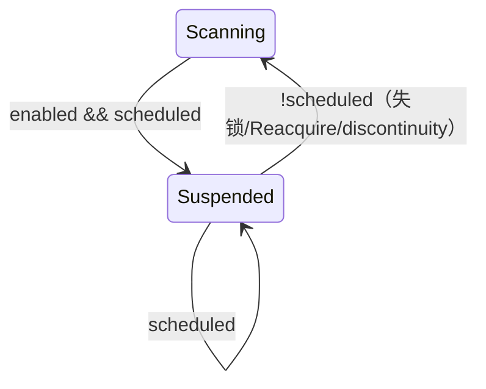

# 开发规划：无干扰监测时锁定后暂停自相关（2026-11-20）

分支：`feature/sic-research`（基线 `5ce858a`）。本文仅为规划，尚未修改代码、未运行验证。

相关报告：[Locked模式候选窗口与目标PRR分析_2026-11-20.md](Locked模式候选窗口与目标PRR分析_2026-11-20.md)

## 1. 背景与现状

`uwb_dw3000_live` 在 `--mode continuous` 下，主线程对每个 RX 块无条件执行原生采样率
（737.28 MS/s，`lag = 750`）的自相关扫描：

```cpp
// gr-uwb/apps/uwb_dw3000_live.cc:1772
if (o.mode != "timed") {
    while (acq.probe+acq.step-1+Acquisition::lag<end) {
        double metric = 0.0;
        const auto seed=acq.scan(ring,&metric);
        if (seed<0) continue;
        submissions.handle_autocorr_seed(seed, metric, valid_begin, cur_pre_guard,
                                         window, o.interference, id, lock, report);
    }
    submissions.submit_ready_acquire_window(end, valid_begin, window, ring, lock, workers, report);
}
```

锁定状态只影响 seed 的去向（`handle_autocorr_seed`，L785-825）：

| 条件 | seed 去向 |
|---|---|
| `!lock.scheduled()`（Acquire / Reacquire） | `pending_seed` → `submit_ready_acquire_window`，`feeds_lock = true`，用于建立锁定 |
| `lock.scheduled()` 且 `--interference on` | 进 `pending`（≤8）→ `classify_candidate`；非 `TargetAssociated` 的提交完整 acq 窗口（即报告中的 `cand_unknown`） |
| `lock.scheduled()` 且 `--interference off` | 仅 `++unknown; ++autocorr_ignored;` 后丢弃 |

`lock.scheduled()` = `tracking()` = `Verify || Locked || Holdover`（`uwb_target_lock_core.h:376-382`）。

**结论**：`--interference off` 且已跟踪时，扫描结果被完全丢弃，`acq.scan` 的 CPU 开销是纯浪费。
`--interference on` 时还额外产生大量 worker 窗口（`cand_unknown`）。

> 说明：`--interference off` 下现有代码已不向 worker 提交锁定期 seed，所以本规划对 worker
> 负担的直接收益来自"把无干扰运行配置为 off 并暂停扫描"；对 `--interference on` 的 worker
> 负担问题，需另行做候选验证（见 §8）。

## 2. 目标与非目标

**目标**
1. `--interference off` 且 `lock.scheduled()` 时停止调用 `acq.scan`，消除 `frontend_scan_us` 中这部分开销。
2. 失锁（转入 Acquire/Reacquire）后能及时恢复扫描，且不漏掉失锁检测延迟期间到达的包。
3. 目标包 FCS/PRR、锁定行为与基线一致（统计口径见 §6）。

**非目标**
- 不改 `--interference on` 的行为与默认值。
- 不改 `Acquisition` 检测算法、阈值、`TargetLockCore` 状态机与 `LockedBounded` 策略。
- 不涉及 `--mode timed`（本就不跑自相关）、TWR、SIC。
- 不引入重采样域互相关前端（另立规划）。

## 3. 设计

### 3.1 开关

新增 CLI：`--autocorr-when-locked scan|suspend|auto`

| 值 | 行为 |
|---|---|
| `scan` | 现状：始终扫描 |
| `suspend` | 跟踪期间暂停；要求 `--interference off`，否则启动时报错退出（fail-closed，避免干扰监测静默失效） |
| `auto` | `--interference off` 时等同 `suspend`，否则等同 `scan` |

- 阶段 1 默认 `scan`（零行为变化）；完成 §5 验证后，再单独提交把默认改为 `auto`。
- `START` 行增加 `autocorr_when_locked=<resolved>`。
- Python wrapper 不改，参数通过 `--` 透传。

### 3.2 门控状态机（纯逻辑，可单测）

新增 header-only 头文件 `gr-uwb/include/gnuradio/uwb/uwb_autocorr_gate.h`（不依赖 UHD，
便于 `lib/` 下 QA 直接包含；`apps/` 下的头文件不在 QA 的包含路径约定内），例如：

```cpp
struct AutocorrGate {
    bool enabled = false;          // resolved suspend
    bool suspended = false;
    // 每个 RX 块调用一次，返回本块是否扫描；恢复时给出 reset 起点
    struct Action { bool scan; bool reset; int64_t reset_at; };
    Action update(bool scheduled, int64_t end, int64_t valid_begin, int64_t lookback);
};
```

状态转换：



- **进入暂停**：不调用 `acq.scan`；`acq.probe` 停止前进。
- **恢复**：`acq.reset(max(valid_begin, end - lookback))`，然后正常扫描追赶积压。
- **RX gap**：现有 `acq.reset(end)` 与 `lock.note_time_discontinuity()` 不变；gap 使锁进入
  Reacquire，门控在下一块自然恢复。
- `submit_ready_acquire_window` 保持每块都调用（暂停前可能留有 `pending_seed`）。

### 3.3 恢复回看量 `lookback`

失锁由 worker 结果反馈触发，存在数个包的延迟，期间的样本仍在 ring
（`history_size = 1<<21` ≈ 2.84 ms @ 737.28 MS/s）中。

- 默认 `lookback = acq_span + window`，保证一个完整自相关窗口加一个包窗口的回看；
  上限受 `valid_begin` 截断。
- 提供 `--autocorr-resume-lookback N`（样点）便于实验；`0` 表示从 `end` 开始。
- 积压扫描是一次性开销；需在验证中记录恢复后首个 seed 的延迟与该块 `frontend_scan_us` 峰值。

### 3.4 与现状的等价性

`--interference off` 且 `scheduled()` 期间，现有代码对 seed 只做计数，不改变锁与 worker 状态。
因此暂停扫描对目标路径**逻辑上等价**，差异只有：

1. `Acquisition` 内部状态（plateau/holdoff）在恢复时被 reset 而非连续延续；
2. 计数器 `acq_seeds` / `unknown` / `autocorr_ignored` 在跟踪期间不再增长。

第 1 点影响失锁后的重捕获延迟，须实测。

## 4. 实现步骤

1. **门控结构**：`AutocorrGate` 放入 `uwb_autocorr_gate.h`，主循环在 L1772 的扫描前调用。
2. **CLI 与校验**：解析 `--autocorr-when-locked`、`--autocorr-resume-lookback`；
   `suspend` + `--interference on` 拒绝启动；更新 `--help`。
3. **统计**：最终统计行新增
   - `autocorr_suspend_events`、`autocorr_resume_events`
   - `autocorr_suspended_samples`（暂停期间跳过的样点数）
   - `autocorr_resume_backlog_samples`（恢复时回看的样点总数）
   - 保留 `frontend_scan_us`、`autocorr_ignored`，并在文档注明口径变化。
4. **单测**：新增 `AutocorrGate` QA（Boost.Test，参照 `lib/qa_uwb_target_lock_core.cc`），覆盖：
   - `enabled=false` 时始终扫描；
   - Acquire→Verify→Locked→Holdover 期间暂停；
   - →Reacquire 恢复，`reset_at` 被 `valid_begin` 截断；
   - 恢复后立即再次锁定、gap 期间切换等边界。
5. **文档**：更新 `docs/原生UHD与C++构建使用说明.md` 参数表与 `开发状态.md`。

## 5. 验证计划

所有构建/测试使用 `env -u LD_LIBRARY_PATH`，不依赖全局 install。

### 5.1 功能回归
- 构建 + 现有 ctest 全量；新增 `AutocorrGate` QA 通过。
- `--autocorr-when-locked scan` 与基线输出逐包一致（同一 replay 文件、同参数）。

### 5.2 回放对照（`--replay FILE`，continuous 节拍回放）
- 夹具：DW3000 1 ms 周期的连续 sc16 IQ 文件（从 `testdata/` 选取或新采集，放 build/临时目录），
  记录来源、时长与哈希。注意 `data_locked_candidates_20261120/` 只有终端关键行日志，
  没有 IQ，不能直接作为回放夹具。
- 配置：`--sync locked --interference off --fused on --cir full --taps eq16`，2 worker，
  `scan` vs `suspend`。
- 有调度反馈，采用 **ABBA 配对**，串行、同环境。
- 指标：
  - 目标路径：`LOCK_STATS fcs_ok / not_detected / fcs_failed / identity_rejects`、
    `lock_entries / holdover_entries / reacquire_entries`；
  - 前端：`frontend_scan_us`、`frontend_us` 占比；
  - worker：提交数、队列丢弃、`demod_us`；
  - 新增计数器。
- 判据：目标 `fcs_ok` 与锁定事件不劣于 `scan`（差异需逐包解释）；`frontend_scan_us`
  在锁定期显著下降。

### 5.3 失锁恢复专项
- 构造/截取含目标停发或 RX gap 的回放段，验证：Reacquire 后重新锁定所需包数、
  恢复后首个 seed 延迟、积压扫描峰值耗时；`lookback = 0` 与默认值对照。

### 5.4 上板（可选，需用户安排）
- X410 实板 `scan`/`suspend` 对照，确认 `RX_GAP`/overflow 不增加。
  未上板前，结论仅标注为"回放证据"。

记录项：提交、CPU 型号、ISA、构建参数、worker/queue、夹具路径与哈希、统计口径。

## 6. 统计口径注意

- 不把 `SUMMARY/FINAL` 总 FCS 率与目标 PRR 混用；`--interference off` 下候选窗口消失，
  `FINAL` 比例会自然接近目标 PRR，这不代表解调性能提升。
- `autocorr_ignored` 在 `suspend` 下趋近 0，属口径变化，不代表误报消失。

## 7. 风险

| 风险 | 缓解 |
|---|---|
| 错锁（Verify 期间锁在错误网格）时扫描已暂停 | Verify 失败即转 Reacquire 并恢复扫描；与现状相同（现状 Verify 期 seed 也被丢弃） |
| 失锁检测延迟导致漏包 | `lookback` 回看 ring 积压 |
| 恢复时积压扫描造成单块耗时尖峰、触发 overflow | 记录峰值；必要时分块追赶（每块限制扫描量） |
| 非目标 UWB 设备出现时无感知 | 设计上仅用于 `--interference off`；需要监测时使用 `on` |

## 8. 后续（不在本规划范围）

- `--interference on` 下的 worker 负担：对自相关候选先做轻量 preamble 互相关验证
  （重采样域局部切片），通过后再提交完整窗口。
- 锁定期以低频局部互相关替代自相关做非目标同码检测。
