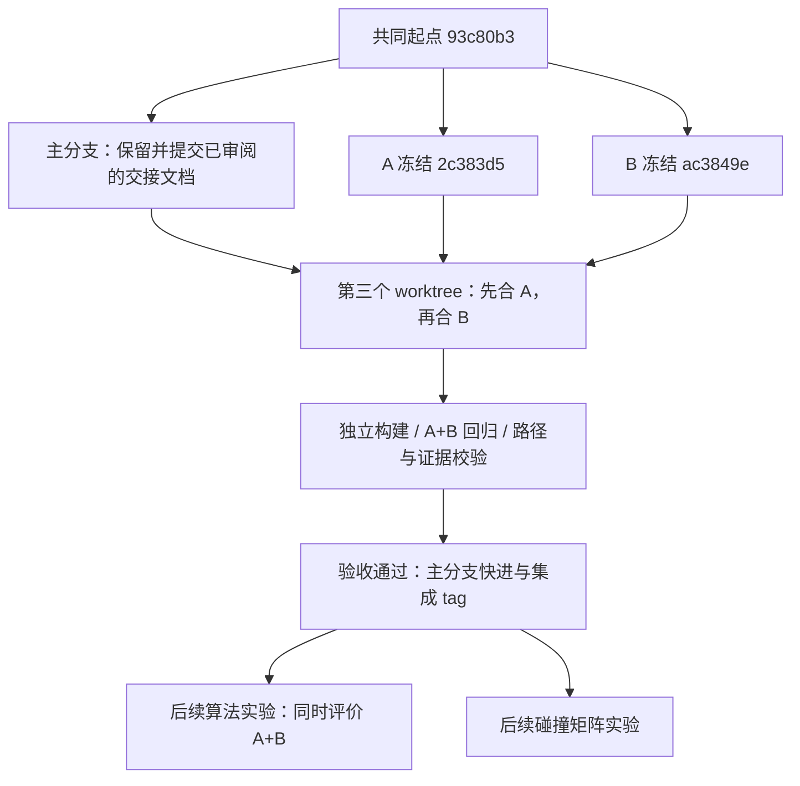

# S2 A/B 冻结与合并执行指南

日期：2026-10-18。用途：交由独立 agent 执行本地冻结、集成、回归和交付。

**本文是执行任务单，不代表合并已经发生。** 编写时只做了只读核对，没有创建 tag、移动分支、合并或重新运行算法矩阵。

## 1. 目标与执行边界

将已验收的 A（累加后 sensing CIR）和 B（sensing 前导干扰通信 payload）合入共同研究基线，保留各自完整提交历史和原始证据。后续算法改进从共同基线新建实验 worktree，能够同时运行 A/B 评价。

本任务允许：本地冻结 tag、证据备份、独立集成 worktree、合并提交、必要的路径/文档/测试入口适配、构建与功能回归；验收完成后本地快进 `feature/sic-research`。

本任务不包含：优化 SIC 数学核心、改变阈值/信道/种子/评价口径、上板、开展新实验方向、修改远程引用或推送、删除历史 worktree/结果、合并旧 `feature/sic-validation`。不以“合并任务”扩大算法修改范围。

用户交付本文作为执行指示后，本文的**本地集成范围**优先于 A/B 历史约定中的“不自动合并”。其他数据隔离、真值、性能和测试规范继续有效。



## 2. 已核对的提交与现场状态

| 对象 | 分支 / 路径 | 编写时完整提交 |
|---|---|---|
| 主分支 | `feature/sic-research`；仓库根 | `93c80b3e77c2caf53cdfab25e09683871806fad8` |
| A | `feature/sic-sensing-accum`；`.worktrees/sic-sensing-accum` | `2c383d50433d939ab1fd65a9c48a8f8b4289cf6e` |
| B | `feature/sic-payload-collision`；`.worktrees/sic-payload-collision` | `ac3849ef77db23838bd1d8d3505dbdee8f84fb09` |
| A/B merge-base | 共同起点 | `93c80b3e77c2caf53cdfab25e09683871806fad8` |

仓库绝对路径：`/home/junqima/workspace/uwb-gnuradio`。

A/B 编写时均为干净工作区。主工作区已有需要保留的内容：

- `.gitignore` 的工作区忽略规则改动。
- `docs/sic/S2_双方向worktree交接入口.md`。
- `docs/sic/obsidian_2026-10-18/`：研究说明、4 幅 PNG/SVG 图、来源 manifest 和绘图脚本。
- 本执行指南；交接入口会更新指向本文。

这些文件不是可清理的临时残留。执行 agent 必须重新检查实际 diff；如有新的无关修改，保留其内容和归属，不能全部 `git add -A`、自动 stash 或覆盖。

原始结果约占：A `results/s2a` **2.5 GiB**，B 整改矩阵 **1.7 GiB**，只是编写时观察值。Git tag 不会保存这些 ignored 文件。

## 3. 执行前先读

1. 本文、仓库 `AGENTS.md`、根目录 `UWB_Preamble_SIC_GNU_Radio_Design.md`。
2. A/B 各自的 `AGENTS.md`、`docs/sic/S2_并行开发共同约定.md`。
3. A：`S2A_整改开发报告_2026-10-18.md`、`S2A_二次复核补充意见_2026-10-18.md`，重点为 §8 和相位参考二轮修复。
4. B：`S2B_整改开发报告_2026-10-18.md`、`S2B_二次复核补充意见_2026-10-18.md`，重点为 B-N01 的可信根约束。
5. 共享 API：`docs/sic/S1_八符号模型API.md`。

执行前确认 A/B session 没有继续写代码或产物；若有，先协调冻结，不终止用户进程。新发现提交不能悄悄代替表中已验收版本：保留后续内容，只合入精确冻结 SHA；若任务确实需要后续提交，先报告差异。

## 4. 第一步：冻结代码和结果证据

### 4.1 只读预检

在仓库根执行并记录输出：

```bash
git status --short
git worktree list
git rev-parse feature/sic-research feature/sic-sensing-accum feature/sic-payload-collision
git merge-base feature/sic-sensing-accum feature/sic-payload-collision
git -C .worktrees/sic-sensing-accum status --porcelain=v1
git -C .worktrees/sic-payload-collision status --porcelain=v1
git diff -- .gitignore
df -h /home/junqima/workspace/uwb-gnuradio
```

还要检查已有 tag、拟建分支、目录是否存在。存在时核对目标，**不覆盖、不强制移动、不重复创建**。`UWB_demodulation` 在 A/B 中为共享 MATLAB 资料的只读链接，冻结与复制均不进入该链接修改内容。

### 4.2 创建本地冻结点

确认 tag 名尚未使用后，创建 annotated tags：

```bash
git tag -a sic-s2-base-20261018 93c80b3e77c2caf53cdfab25e09683871806fad8 -m "S2 shared S1 baseline before A/B integration"
git tag -a sic-s2a-accepted-20261018 2c383d50433d939ab1fd65a9c48a8f8b4289cf6e -m "S2-A accepted after A-N01/A-N02 second-round review"
git tag -a sic-s2b-accepted-20261018 ac3849ef77db23838bd1d8d3505dbdee8f84fb09 -m "S2-B accepted after B-N01 trusted-root review"
```

“accepted”表示当前交付/整改验收，不表示所有算法条件达到性能目标。保留 A/B 分支和原 worktree，不 rebase/squash/amend 它们。

### 4.3 冻结 ignored 证据

建立唯一的新证据目录，例如仓库下 `build-artifacts/sic-freeze-20261018/`；先检查目录不存在或确认为本任务未完成产物，并设置忽略规则。磁盘不足时先完成代码冻结与清单，明确报告证据备份阻塞，不用空目录宣称冻结完整。

至少保存以下内容的**只读副本或归档包**，原路径保持不动：

| 证据组 | 必需内容 |
|---|---|
| A | `gr-uwb/build-sic-accum/results/s2a/` 中 smoke/calibration/acceptance/bypass/budget 的整改 run，以及二轮诊断 QA 日志 |
| B | `gr-uwb/build-sic-payload/results/s2b_matrix_rectification/`，32 cell 的 plan/manifest/windows/summary/recon 及矩阵配置、派生图表 |
| 运行库 | manifest 实际引用的 A/B 共享库、Python bindings、相关 build 配置与依赖环境记录；解析 symlink 保存实际目标并记录原路径 |
| 源码 | 上述三个 tag 的 Git bundle；最终报告、API、冻结配置与源码 SHA-256 清单 |

要求执行 agent 编写小型冻结清单工具或使用可审计归档命令，输出：原绝对路径、相对路径、大小、SHA-256、源提交、dirty 状态、归档包 SHA-256。对原 run 的全部已存在文件做清单，复制后逐文件/逐条目验证相同。记录未包含的历史 run，不能把选择性冻结表述为所有历史实验均已备份。

不能只复制 summary，也不能重新运行生成器来冒充原证据。**hash 是完整性记录，不是备份；Git bundle 保存源码，不保存 ignored IQ。** 二进制与原 build 路径保留，是历史库校验还能继续工作的前提。

冻结后再计算一次原始清单摘要，后续集成交付时复核没有变化。生成额外分析图必须指定新输出目录；例如 B aggregate 默认会写输入矩阵目录，复核历史 run 时必须显式使用 `--out-dir`。

输出 `docs/sic/S2_AB冻结清单_2026-10-18.md`，大文件放 ignored 证据目录，文档只记录引用、hash、范围与验证结果。

## 5. 第二步：隔离集成，保留主工作区文档

### 5.1 先保存已审阅的主分支文档

对第 2 节列出的主工作区内容逐文件审阅，用明确路径 `git add`，单独提交为文档/交接 checkpoint。忽略规则只包含需要忽略的 `.worktrees/`、本任务证据/构建产物；不加入会隐藏源文件或测试 fixture 的广泛规则。

该 checkpoint 允许将本指南、研究说明和冻结清单带入共同基线。不要把 A/B 原始实验产物或不相关用户修改一起提交。记录 checkpoint SHA，作为下文创建集成分支的起点。

若有无关 dirty 内容，可继续在独立 worktree 集成，但主分支最后 promotion 前必须确保其更新不会覆盖用户内容；不能擅自 stash/提交无关修改来凑出 clean。

### 5.2 创建第三个 worktree

在检查分支和目录均不存在后，从刚保存的主分支 checkpoint 创建：

```bash
git worktree add -b integration/sic-s2-ab-20261018 .worktrees/sic-s2-integration feature/sic-research
```

后续所有合并、冲突解决、代码适配、构建和新结果只在：

`/home/junqima/workspace/uwb-gnuradio/.worktrees/sic-s2-integration`

执行。若需要 MATLAB 参考，按已有约定建立指向主仓库资料的只读使用链接；不复制修改 canonical 资料。

### 5.3 先合 A，再合 B，保留 merge history

在集成 worktree 中，先运行以下第一条，处理冲突、检查 diff 并提交后，再运行第二条。使用固定 SHA，不使用可能继续移动的分支名：

```bash
git merge --no-ff --no-commit 2c383d50433d939ab1fd65a9c48a8f8b4289cf6e
```

```bash
git merge --no-ff --no-commit ac3849ef77db23838bd1d8d3505dbdee8f84fb09
```

每次合并解决全部冲突后，先 `git diff --check`、检查 `git ls-files -u` 为空、审阅 staged diff，再创建明确的 merge commit。必要的集成适配另作小提交，便于区分原交付与集成修改。

## 6. 冲突与共享文件处理规则

编写时 A/B 主要代码分离，重叠文件为 `.gitignore`、`AGENTS.md`、`OPENCODE_START.md` 和共同约定；B 额外修改 `gr-uwb/apps/CMakeLists.txt`。实际以 merge 输出为准。

| 文件 / 内容 | 处理要求 |
|---|---|
| `AGENTS.md` | 顶部改为“已验收 A/B 集成基线”，列两方向入口和统一回归；保留通用规范、冻结核心、真值隔离、当前未实跑边界；不能只保留 A 或 B 的优先任务 |
| `OPENCODE_START.md` | 改为统一入口，链接 A/B 最终报告、本文和集成报告；旧单方向操作说明可保留为历史文件 |
| `S2_并行开发共同约定.md` | 保留历史内容，顶部注明原双分支阶段已结束、当前集成范围由本文定义；不删除证据/性能纪律 |
| `S2_双方向worktree交接入口.md` | 更新实际状态与新的共同基线，保留原 worktree/冻结 tag 的索引 |
| `.gitignore` | 合并所需规则，保留 fixture；大 IQ、build、冻结包不得入 Git |
| `gr-uwb/apps/CMakeLists.txt` | 保留 B 的 `uwb_qa_sic_payload_py` 与 `UWB_BUILD_DIR=${CMAKE_BINARY_DIR}`、空 PYTHONPATH 等设置；不得丢失已有 tests |
| A/B 最终报告及旧结果 | 原样保留历史事实，在集成报告补充当前状态；不替换旧 commit、库路径、hash 来使旧报告看起来来自新版本 |
| 研究说明与绘图脚本 | 保留原来源与图；脚本当前读取主仓库下 A/B worktree，集成后检查使用说明，不在新 worktree 中假设相同嵌套目录存在；需要适配时使用显式 source-root 参数 |

禁止对所有冲突批量选 `ours` 或 `theirs`。两份内容看似一样也要检查其约束是否正确，不能用“测试一致”替代语义审阅。

### 6.1 共享 SIC 数学与 adapter 必须保持冻结

相对 `93c80b3` 核对下列文件无变化，并记录 blob/hash：

- `gr-uwb/include/gnuradio/uwb/uwb_preamble_sic_core.h`
- `gr-uwb/lib/uwb_preamble_sic_core.cc`
- `gr-uwb/include/gnuradio/uwb/uwb_preamble_sic.h`
- `gr-uwb/lib/uwb_preamble_sic.cc`
- `tools/sic/sic_reference.py`
- 现有 `qa_uwb_preamble_sic_core.cc` / `qa_uwb_preamble_sic.cc` 及其原门槛。

编写时检查的核心/header/adapter/reference 在 A/B 中均与共同基线一致。若集成需要修改这些文件，先给出最小复现与影响，停止该修改，不能把新算法混入本次合并。

### 6.2 本轮保留两个 build，统一的是源码基线

集成 worktree 内继续使用：

- A：`gr-uwb/build-sic-accum`
- B：`gr-uwb/build-sic-payload`

两个 build 都来自**同一集成提交**，串行构建，不复制旧 CMakeCache、不软链旧 build，不安装到 `/usr/local`。这样既减少路径适配风险，也直接符合 B verifier 的默认可信 build 规则。统一成单个 build 不是本次验收前置条件。

### 6.3 B verifier 的信任根不能回退

现有 `verify_s2b.py` 已支持 `--repo` 和 `--trusted-build`，默认从 verifier 自身所在源码根推导 `gr-uwb/build-sic-payload`。因此换到集成 worktree 后**通常无需更改验证算法**。

新 run 必须以集成源码根为可信根，仅接受本集成 build 的实际库与 bindings 路径/hash。`s2b_aggregate.py` 也要用集成副本运行新矩阵。

历史 run 在原 B worktree 中用原 verifier 复核，或显式指定**独立核对过的历史可信根**。不能用新 run 自报的 `build_dir` 推导可信目录；不能为迁移放宽到“仓库任意子目录”。父仓库、旧 A/B、`/usr/local`、symlink 逃逸和 bindings hash 篡改必须继续被拒绝。

若必须新增 aggregate 的 trusted-root 透传参数，先加针对性 QA；该参数来自操作者，不可从被验证 manifest 自动读取。保留所有现有 19 个 B 负样本。

## 7. 第三步：集成验收

正式验收前先提交所有影响运行的源码/配置修改，使新 run 绑定明确的集成提交。报告之后可另作纯文档提交；记录 code-tested SHA 与最终文档 SHA，不改写 manifest。复跑输出必须使用新目录，不能覆盖先前失败或成功的 run。

### 7.1 构建与回归

以下命令都在集成 worktree 执行，A/B 构建串行：

```bash
env -u LD_LIBRARY_PATH cmake -S gr-uwb -B gr-uwb/build-sic-accum -DCMAKE_BUILD_TYPE=Release -DENABLE_DOXYGEN=OFF
env -u LD_LIBRARY_PATH cmake --build gr-uwb/build-sic-accum -j2
env -u LD_LIBRARY_PATH cmake -S gr-uwb -B gr-uwb/build-sic-payload -DCMAKE_BUILD_TYPE=Release -DENABLE_DOXYGEN=OFF
env -u LD_LIBRARY_PATH cmake --build gr-uwb/build-sic-payload -j2
env -u LD_LIBRARY_PATH ctest --test-dir gr-uwb/build-sic-accum --output-on-failure -R 'preamble_sic|radar_cir|sic_payload'
env -u LD_LIBRARY_PATH ctest --test-dir gr-uwb/build-sic-payload --output-on-failure -R 'preamble_sic|radar_cir|sic_payload'
env -u LD_LIBRARY_PATH python3 testdata/sic_accum/qa_s2a.py
env -u LD_LIBRARY_PATH python3 tools/sic/verify_s2b.py --self-test
```

用 `ldd` 核对两个 build 的 SIC 测试二进制，进程 maps/manifest 核对 Python run 实际加载的库和 bindings；不能只检查文件存在。QA 不得把缺 build 导致的 SKIP 当作集成通过。检查 CTest 实际匹配到的测试数，不接受空匹配成功。

### 7.2 A：原矩阵的 8 窗代表性回归

运行全部 12 条件各 8 窗，保留原 acceptance 种子与配置，仅用于集成回归，不当作新的独立统计研究：

```bash
env -u LD_LIBRARY_PATH python3 gr-uwb/apps/uwb_sim_sic_accum.py \
  --build-dir gr-uwb/build-sic-accum \
  --output gr-uwb/build-sic-accum/results/s2a/integration_20261018 \
  --stage integration_20261018 --seed-set acceptance \
  --windows-per-cell 8 --archive-windows 8 --receiver --receiver-windows 8
env -u LD_LIBRARY_PATH python3 tools/sic/verify_s2a.py \
  --run gr-uwb/build-sic-accum/results/s2a/integration_20261018 --reject-qa
env -u LD_LIBRARY_PATH python3 gr-uwb/apps/uwb_sim_sic_accum.py \
  --build-dir gr-uwb/build-sic-accum \
  --output gr-uwb/build-sic-accum/results/s2a/integration_bypass_20261018 \
  --stage integration_bypass_20261018 --seed-set acceptance \
  --cell isr10_cfo0_single --windows-per-cell 8 --archive-windows 8 --bypass
```

对旁路 run 也调用 verifier。新增 run 与 A 历史 acceptance **同 cell、同 window_id、同 seed 的前 8 窗**配对比较，不能拿 8 窗均值与 100 窗均值要求相等。

必须保持：合法独立区 r=9…62、相干能量归一化、目标保护、逐字节旁路、成功/失败计数。旧 56 符号诊断和新 54 符号主指标分别保留。物理结果若有差异，先核查输入 hash、profile、库/编译环境；不自动扩大容差或修改门槛。数值容差沿用现有契约，缺少跨构建容差时报告实际差异并解释，不宣称 bit-exact。

A-N02 至少使用已冻结的 24 窗预算归档做 `--verify-baseline`，并复算原 16 窗有界搜索；输出写到**集成新目录**。此项是旧数据的新诊断验证，不能标为新 GNU Radio 采集结果。保留非零 CFO/相位参考的拒绝反例。

### 7.3 B：覆盖关键行为的小矩阵

不用 `--matrix` 作为默认 smoke：当前该选项会展开完整 24200 包。也不能只用 `--smoke`，因为该入口固定为 b0，不能覆盖真实碰撞恢复。

下列单条件命令是现有 CLI，可作为 ISR20 高 SNR 代表：

```bash
env -u LD_LIBRARY_PATH python3 gr-uwb/apps/uwb_sim_sic_payload.py \
  --build-dir gr-uwb/build-sic-payload \
  --output gr-uwb/build-sic-payload/results/integration_20261018/b2_snr8.0_isr20 \
  --phase b2 --seed-set acceptance --windows 8 --archive-windows 8 \
  --snr-db 8 --isr-db 20 --position center --cfo-hz 0 \
  --comm-channel single --interferer-paths single --interferer on
env -u LD_LIBRARY_PATH python3 tools/sic/verify_s2b.py \
  --results gr-uwb/build-sic-payload/results/integration_20261018/b2_snr8.0_isr20
```

执行 agent 按冻结 `stages.json`/原 `matrix.json` 生成其余命令，每格 8 窗，字段与原条件一致：

| 覆盖点 | 必跑条件 |
|---|---|
| 无干扰与名义 | B0 clean；B1 center / ISR10 / SNR30 |
| ISR20 恢复与噪声边界 | B2 SNR8 / ISR20；B2 SNR−3.5 / ISR20 |
| 前后位置 | B3 early 与 late，SNR−3.5 / ISR10 |
| 正式多径/CFO | B3 official four / CFO−50k、+50k / ISR10 / SNR30 |
| 负样本 | B4 无 sensing、wrong_code11、no_overlap |

共 11 个代表条件，每格 8 窗。每格严格 verifier；保留 config/seed/window_id/raw/clean/input hash 与历史同窗配对，逐包对照 PSDU/FCS/status/rescue/damage。抑制度只比较相同 mask；不要求每个小样本单元复现原总体错误率。

该小矩阵不宣称完成正式 32-cell matrix；不能伪造 matrix.json 让缺条件检查通过。每格运行单条件 verifier，另生成名为 integration smoke 的汇总。如果新增 smoke runner，把“正式矩阵完整性”与“小矩阵覆盖清单”明确区分。

补验证新 worktree 可信根拒绝旧库：联合修改副本 manifest 的 build_dir、library 和正确旧库 hash 仍必须失败；bindings 篡改与 symlink 逃逸也应失败。所有篡改仅在新临时副本进行，不动冻结证据。

### 7.4 历史结果核验与是否扩大回归

完整旧 A/B 结果继续以原提交、原库、原路径为证据。用各自原 verifier 复核，日志和派生输出保存到集成证据目录；原始 hash 必须保持不变。

默认不重跑 1200/24200 全矩阵。以下变化才触发受影响矩阵重跑：生成器、数学核心、解调算法、随机性、mask/ROI、指标、默认参数或门控发生变化；此类变化通常已超出纯集成，先给出差异与必要性。仅入口文档、可信路径适配、构建注册变化，可由针对性 QA + 同窗回归证明。

本任务不采正式性能数字。若顺手记录 wall time，只写诊断值。以后正式 benchmark 必须独占协调并使用 `/tmp/uwb-sic-benchmark.lock`；功能回归通过不等于 mean≤0.5 ms、P99≤1 ms 或 200 窗/s 已通过。

## 8. 第四步：完成集成与主分支 promotion

只有下列条件全部满足，才把主分支快进到集成结果：

- [ ] A/B 精确冻结 tag 与证据备份校验完成，原始文件未改变。
- [ ] A/B 冻结提交都是集成 HEAD 的祖先；共享核心/adapter/原 QA 与基线一致。
- [ ] 两个独立 build 的实际加载库/bindings 正确，全部针对性 QA 通过且无必需项 SKIP。
- [ ] A 12 格代表回归、旁路、A-N02 基线/诊断通过；B 11 格代表回归、严格路径反例通过。
- [ ] 与历史同窗的输入、状态、包结果及关键指标对照已记录；差异有证据解释。
- [ ] 历史完整矩阵复核与新 smoke 结果在报告中分开；失败/未跑项没有改成通过。
- [ ] `AGENTS.md`、统一入口、文档、测试注册无单方向覆盖或过时任务状态。
- [ ] 已提交全部集成改动，集成 worktree 干净，报告记录 code-tested SHA。

运行 `git merge-base --is-ancestor` 分别检查两个冻结 SHA 与当前主分支 checkpoint 都是集成 HEAD 的祖先。再回到主 worktree，检查它仍在 `feature/sic-research`，没有未处理的重叠 dirty 修改，且没有新的并行提交。

```bash
git merge --ff-only integration/sic-s2-ab-20261018
git tag -a sic-s2-ab-integrated-20261018 HEAD -m "Integrated accepted S2-A and S2-B; integration regressions passed"
```

若 `--ff-only` 失败，停止 promotion 并说明原因；不强制 reset/rebase。tag 已存在时只核对，不 `-f`。不推送远程，不删除 A/B/集成分支或 worktree。

## 9. 回退与异常处理

集成未完成时，A/B 冻结 tag 和原 worktree 不受影响。合并冲突无法可靠解决，可在**确认当前目录为集成 worktree、确实有 MERGE_HEAD、合并前干净**后执行 `git merge --abort`；合并过程中新增的重要诊断先保存到任务证据目录。

构建/测试失败时保存日志与失败 run，继续不受影响的检查；不能清理后假装首次运行通过。禁止 `git reset --hard`、`git clean -fdx`、强制 checkout 或删除整个 build 来实现回退。

主分支 promotion 后若发现问题，保留集成 tag 和证据，从旧冻结 tag 创建新的恢复分支进行分析；需要撤回时另做可审阅 revert，不强制移动已有主分支或覆盖历史 tag。本指南不预先授权破坏性回退。

## 10. 最终交付

执行 agent 提交：

1. `docs/sic/S2_AB冻结清单_2026-10-18.md`：冻结 SHA/tag、文件/归档校验、保存位置和未包含范围。
2. `docs/sic/S2_AB集成验收报告_2026-10-18.md`：合并提交图、冲突处理、适配 diff、code-tested SHA、实际库路径/hash、所有命令与结果、同窗对比、已知限制。
3. 可重跑的集成 smoke 入口/明确命令清单；新增 runner 必须区分 smoke 与正式矩阵。
4. 更新后的统一 `AGENTS.md` 和 `OPENCODE_START.md`。
5. 说明主分支是否已快进、集成 tag 指向何处；如未完成，写清阻塞点和保留现场。

报告必须保留研究结论边界：A 名义 CIR 约 28.4 dB、残余高度相干；困难 CFO 的 12.61 dB 是离线诊断空间；B 的 ISR20 恢复适用于已测单径/零 CFO 条件；当前 A/B 未完成正式实时、native、MATLAB、FPGA/硬件验收。

当前 A/B 分支在本次交付后继续作为历史锚点。后续建议从 `sic-s2-ab-integrated-20261018` 分别建立算法改进和碰撞扩展 worktree；**本任务只提出此安排，不自动启动后续实验**。

## 可直接粘贴给执行 agent 的指令

> 请执行 `/home/junqima/workspace/uwb-gnuradio/docs/sic/S2_AB冻结与合并执行指南_2026-10-18.md`。先完整阅读并核对现场，冻结 A=`2c383d5`、B=`ac3849e` 的代码与结果证据，保留主工作区已有文档。创建第三个集成 worktree，先合 A 后合 B，保持共享 SIC 核心和指标不变，完成指南中的构建、A/B 同窗回归与可信路径校验。通过后仅在本地快进 `feature/sic-research` 并创建集成 tag，不推送、不删除历史 worktree、不自动进入下一轮算法或硬件开发。提交冻结清单、集成验收报告和统一 agent 入口；失败与未跑项如实记录。
