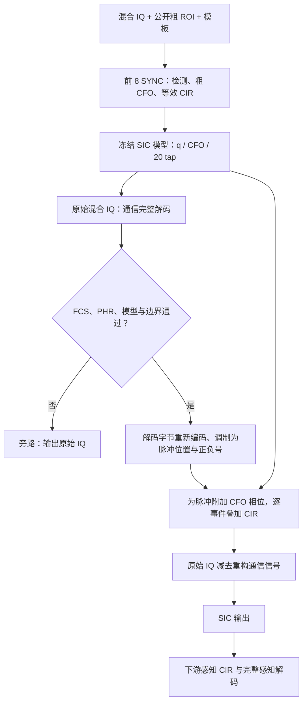
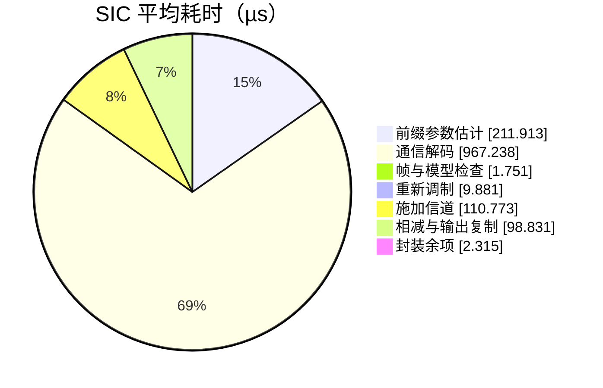

# SIC 完整流水线与 MATLAB 对齐

这份说明对应当前 **C++ 全包 SIC：Ipatov 相关 CIR + 稀疏脉冲重构 + fast RX**。MATLAB 先复现这条路径，再研究更省计算的同步方法。

代码位置：`/home/junqima/workspace/uwb-gnuradio/.worktrees/sic-fullpacket-compare`，分支 `feature/sic-fullpacket-compare`，当前 HEAD `cc47799`。以下讨论过的延迟自相关、抽样 SYNC 跟踪尚未实现。

## 一眼看懂流程



**有两套独立估计。** 前缀估计器给 SIC 重构提供参数；通信解码器重新估计定时、CFO 和 CIR 来恢复字节。当前没有用解码器的精修参数更新 SIC 模型。

## 当前耗时

最新验收 compact 四径、32 B PSDU，两个新版本计时轮次共 128 次，平均 SIC **1402.7 µs**。



下游感知 CIR 为 **442.8 µs**，完整感知解码为 **2148.5 µs**；连同 SIC，全流程 service 约 **3994.0 µs**。它们是处理耗时，排队、采样等待和文件读写不按这个数字解释。

原始记录：`gr-uwb/build-sic-fullpacket-agy-opt/results/rectification_20261108_123827/`，使用 `r2_new/windows.jsonl`、`r3_new/windows.jsonl`。测量时是提交前的开发状态，provenance 记录 HEAD 为 `6b28def`；二进制和动态库由哈希绑定，不能把这些数字写成干净 `cc47799` 重新构建的测量。

## 1. 输入与坐标

| 项目 | 当前配置 |
|---|---|
| 输入 | 混合复数 IQ，CF32，236416 点 |
| 采样率 | 998.4 MS/s |
| 通信 / 感知码 | Ipatov code 10 / code 9 |
| SYNC | 64 个；每个 1016 sample = 508 chip |
| SFD | 4z2，8 个 SYNC 长度的符号 |
| PHR / payload 速率 | 0.85 / 6.81 Mb/s |
| PSDU | 32 B，包含末尾 2 B FCS |
| SIC 可见前缀 | `[0,10560)` |
| 粗搜索 ROI | `[1792,2304)` |
| SIC CIR 支持 | 20 tap，lag 为 `-1…18` |
| 重构事件数 / 基带长度 | 8384 个 / 133568 sample |

全文使用 **0-based 样点索引、左闭右开区间**。MATLAB 访问第 n 个样点使用 `iq(n+1)`。C++ 峰位置使用符号末端约定：`peak = sync_start + template_length - 1`；不能直接把它当作前导起点。

`q` 是相关估计出的参考起点，不必等于注入时延或物理首径。负 lag 的 tap 放在 `q-1`；相减必须沿用这个坐标。

## 2. SIC 前缀参数估计：211.9 µs

入口：`uwb_discrete_cir_estimator.cc::estimate_discrete_cir`，`fit_reps=8`。所有信号读取受可见前缀限制。

### 检测与重复确认：130.1 µs

先对可见前缀建立能量前缀和并检查数值，再在粗 ROI 内用**带 pulse shaping 的公开 SYNC 波形**做归一化匹配，选取起点 q。搜索步长 1，检测阈值 0.40。

随后在 `q+k×1016` 检查前 8 个重复，至少 2 个超过阈值才继续。这里的带成形模板用于捕获；后面的 CIR 估计换成单位脉冲码。

### 粗 CFO：1.2 µs

对相邻有效 SYNC 的复相关值做共轭乘积，单位幅度化后累加，用相位差求 CFO：

$$\hat f=\frac{f_s}{2\pi T}\arg\sum_k\frac{C_{k+1}C_k^*}{|C_{k+1}C_k^*|}.$$

当前 8 SYNC 配置从 k=1 的相邻对开始；T=1016 sample。模型相位参考点为 q。

### 等效 CIR：27.0 µs

1. 用估计 CFO 将前缀 IQ 去旋转，相位原点是 q。
2. 跳过第一个 SYNC，累加完全位于前 8 SYNC 内的窗口。窗口宽 `1016+20-1=1035` 点；当前通常实际使用 6 个重复。
3. 与**未带成形的单位 Ipatov 脉冲序列**做前向相关，除以码能量与重复数。

Ipatov 原码长 127，非零值为 ±1；当前每 8 个 sample 放一个码元素。对 lag ℓ，等价表达为：

$$\hat g[\ell]=\frac{1}{R E_c}\sum_k\sum_{j:c_j\ne0}c_j\,y[q+kT+\ell+8j]\,e^{-j\omega(kT+\ell+8j)}.$$

这里的 g **包含发射脉冲成形及传播信道的等效响应**，保留幅度和相位，不做单位范数归一化。后面用单位脉冲激励它，避免重复成形。

当前 Ipatov 分支直接保留全部 20 tap，**没有稀疏路径选择、数据投影或 LS 求解**。源码中的这些旧分支不属于本流程。

### 残差检查：39.1 µs

使用单位脉冲训练序列与 g 重构训练段，加回 CFO，计算：

$$\epsilon=\frac{\sum|y-\hat y|^2}{\sum|y|^2}.$$

超过 0.8 则拒绝。它验证当前模型能否解释训练数据，不重新拟合 CIR。实现利用周期模板复制减少重复构造。

剩余约 14.5 µs 为配置、准备状态、模型冻结与封装等开销。冻结字段包括 q、CFO、phase reference、lag_lo、taps、训练支持及模型标识。

## 3. 通信完整解码：967.2 µs

入口：`fullpacket_rx_pipeline.h::FastRxPipeline` → `uwb_demod_core.h::demodulate_one`。读取**原始混合 IQ**，seed 为 SIC 的 q，模板为公开带成形 SYNC。

| 阶段 | 平均耗时 |
|---|---:|
| 初始 SYNC 定时 | 376.6 µs |
| 初始 CFO 与局部去旋转 | 10.1 µs |
| SFD 与同步精修 | 380.9 µs |
| CIR 与 soft-chip 准备 | 75.1 µs |
| soft-chip SFD 定位 | 39.9 µs |
| PHR | 16.2 µs |
| payload | 64.4 µs |
| 顶层余项 | 4.1 µs |

### 3.1 SYNC 定时

在 seed 附近捕获，当前初始搜索 margin=256，步长 1。沿 1016 点周期逐个跟踪最多 64 个 SYNC，每次在预测位置 ±8 sample 内做局部匹配。保留峰位置和复相关值，对“符号编号—峰位置”拟合直线，得到起点及实测周期。

还保留弱起始 SYNC 的回溯逻辑。当前 `seed_refine_tail` 只优化后面的尾部捕获，不表示初始 64 个 SYNC 已改为抽样跟踪。

### 3.2 初始 CFO

对 SYNC 相关相位解缠后做线性拟合。默认最多跳过前 24 个峰，同时至少保留 32 个；64 峰完整时使用后 40 个。先只旋转 bootstrap SFD 搜索需要的 IQ 区间。

### 3.3 SFD 锚定与精修

| 内部步骤 | 平均耗时 |
|---|---:|
| 首次 SFD 波形搜索 | 78.9 µs |
| 尾部约 40 SYNC 重新跟踪 | 171.5 µs |
| 重拟合 CFO 与区间去旋转 | 49.0 µs |
| 最终 SFD 波形搜索 | 78.5 µs |
| 锚点调整等 | 3.0 µs |

首次 SFD 用于修正前导符号编号，避免弱起始符号造成错位。再从 SFD 向前预测尾部 SYNC 区，重新跟踪、估计 CFO，最后再次确认 SFD。启用尾部 ±8 窄捕获，失败回到原搜索。

CFO 补偿为 `r[n] exp(-j 2πfn/fs)`，RX 相位原点是窗口样点 0。快速实现分块生成旋转表，用 VOLK 复乘，每 1024 点重新锚定；payload 在 PHR 解出长度后按需补旋转。

### 3.4 通信 CIR、SFD soft-chip 与相位

这套 CIR 用于**匹配滤波和解码**，与 SIC 的 20 tap 不同：

- 跳过前 10 个 SYNC，最多累加后 54 个，对齐采用实测周期。
- 平均 IQ 后，与未成形 Ipatov 采样码相关一次。
- `pre=8, post=30`，总计 **38 tap**；归一化 CIR，并保存其复共轭作为 CMF 系数。
- SYNC 区不生成整段 soft-chip FIR；通过专门的 SYNC 相位估计得到公共相位。
- 仅在 SFD 所需区间生成约 **4081 个 chip** 的 CMF 输出。
- 旋转取实部、峰值归一化；跳过的前导 chip 前缀置零以保留绝对 chip 坐标。

本阶段 75.1 µs = CIR 15.3 + FIR 41.5 + 后处理 16.4 + 余项约 2.0。后处理已经包含 SYNC 相位估计 8.2 µs，不能重复相加。

### 3.5 soft-chip SFD 定位

在预期 `64×508` chip 附近 ±8 chip，用 `SFD极性序列 ⊗ Ipatov展开码` 做归一化相关，确定 chip 域的 SFD 边界和极性，供 PHR 定位。

这是前面两次 IQ 波形域 SFD 搜索之外的一次定位，MATLAB 复现时需要保留。

### 3.6 PHR 与 payload：融合解扩 / CMF

两者均使用 fused CMF：把 PN 解扩和短 CIR 的作用组合为局部模板，直接对 CFO 补偿后的 IQ 计算 BPM 候选度量；**没有先生成完整 PHR/payload soft-chip FIR 流**。

可以理解为将“先 CMF 再解扩”的线性运算合并、交换求和顺序，并保留所需候选输出；不等于把每个符号压成一个标量后再做普通 FIR。

以 h 为匹配滤波系数、a 为 PN 正负号，融合模板为 `t[m]=Σ_{q+2c=m} h[q]a[c]`，候选度量为 `Re(rot×Σ_m t[m]r[base+offset+m])`。当前几何如下：

| 字段 | burst 长度 | 每符号 chip | 4 个候选 chip 偏移 | 38 tap 对应模板长度 |
|---|---:|---:|---|---:|
| PHR | 64 | 512 | 0, 256, 64, 320 | 164 sample |
| payload | 8 | 64 | 0, 32, 8, 40 | 52 sample |

PHR 输出速率、PSDU 长度及 19 个 PHR 位；处理 SECDED 等头部约束，并保留供后续联合解码使用的判决。当前 21 个 PHR 调制符号。

payload 根据 PHR 长度建立模板，输出 BPM/BPSK 度量，完成卷积码、RS 及字节恢复，检查 FCS。32 B PSDU 对应 304 个 payload 调制符号。

| 内部步骤 | PHR | payload |
|---|---:|---:|
| 模板构建 | 10.5 µs | 23.6 µs |
| 融合相关 | 3.0 µs | 10.5 µs |
| 译码 | 0.5 µs | 9.7 µs |
| 余项，含阶段内区间旋转等 | 2.1 µs | 20.6 µs |

PHR/payload 共用的编码状态和尾位边界应按代码复现，不能各自另起一个独立卷积译码器。源码入口为 `stage_phr_fused_cmf`、`stage_payload_fused_cmf` 及 `uwb_rx_fused_cmf.h` 中的实现。

融合路径目前要求整数 2 sample/chip 等条件。不能执行或解码失败时有完整 soft-chip 路径回退。最新计时 128 次均未触发相关回退；研究 SFO 时需记录实际走的分支。当前区间 CFO 补偿的保护条件只检查名义采样率，未严格检查实测周期，这是已发现的待修点。MATLAB 在分数周期下应以实测 sample/chip 确定取样位置和补偿覆盖范围，不将该保护条件当作算法要求。

## 4. 帧与模型检查：1.8 µs

使用通信解码得到的真实字节和 PHR。检查 FCS、长度、支持的 PHY、重新编码的 PHR 一致性、模型及输出边界，通过后才提交消除。

稀疏事务路径不再对整窗 IQ 做 NaN/Inf 扫描；前缀估计中的数值检查仍保留。

## 5. 重新调制：9.9 µs

入口：`uwb_hrp_mod_core.h::modulate_pulse_list`。

```text
解码 PSDU（含原 FCS）
→ LSB-first bits、RS 编码
→ 生成 PHR、组合卷积编码与尾位
→ BPM/BPSK、PN 扩频和跳位
→ 输出 (sample_offset, sign) 列表
```

SYNC/SFD 前缀事件与 PN 序列按配置缓存，随包变化的 PHR/payload 决定实际事件。输出正负号为 ±1，零位置不存储。

没有整包浮点波形、峰值扫描或整包实数转复数；也没有再次做 pulse shaping。32 B 当前输出 8384 个事件，覆盖 133568 点基带长度。

## 6. 施加信道：110.8 µs

入口：`uwb_discrete_cir_reconstruct.cc::apply_discrete_cir_pulses_impl`。

| 操作 | 平均耗时 |
|---|---:|
| 尺度 / 模板准备余项 | 0.2 µs |
| 重构缓冲区清零 | 52.1 µs |
| CFO 旋转表准备 | 3.0 µs |
| 事件 CIR 叠加 | 55.2 µs |
| 其他小余项 | 约 0.3 µs |

对事件 `(p_i,s_i)`，在位置 `q+p_i+lag_lo` 放入带权 CIR：

$$\hat i[q+p_i+\ell]\;{+}{=}\;s_i e^{j2\pi\hat f p_i/f_s}\hat g[\ell],\qquad\ell=-1,\ldots,18.$$

重叠位置继续累加。20 tap 使用 AVX2/FMA 专用实现，其他条件有通用回退。CFO=0 时直接加减；非零时在事件位置计算额外相位。

这里采用**CFO 在短 CIR 时长内近似不变**，不对每个 CIR tap 再旋转。相位原点为 q，与 SIC 估计一致；不再对重构整包进行第二遍 CFO 旋转。

当前代码登记的重构支持为 `[q+lag_lo, q+lag_lo+packet_samples+tap_count)`，比通常的 N+K−1 卷积长度多保留一个尾部样点；MATLAB 对齐输出边界时沿用此约定。支持、消费者 ROI 和输入缓冲范围按实现校验，不能自行裁掉未观测的包尾再宣称完整消除。

## 7. 相减和输出：98.8 µs

在支持与消费者 ROI 的交集内写 `out=y-ihat`，其余位置复制 y。成功路径避免预先复制一次整窗后又重复覆盖。失败时旁路原始 y，返回原因。

没有最终整包 NaN/Inf 扫描。`committed=true` 表示通过事务检查并完成相减；消减效果仍需离线用残余指标评价。

## 8. MATLAB 如何与 C++ 对齐

### 直接复用现有离线数据

输入目录位于工作树下：

```text
gr-uwb/build-sic-fullpacket-pulse-list/results/
  compact_channel_20261108/inputs/payload_four_frac/
```

先读 `public.json`，再读 `comm_sync.cf32`、`comm_preamble.cf32`、`sensing_sync.cf32` 和 `windows/*/raw.cf32`。CF32 是交错的 float32 实部、虚部：

```matlab
fid = fopen(path, 'rb', 'ieee-le');
a = fread(fid, [2, Inf], 'single=>single');
fclose(fid);
iq = complex(a(1,:), a(2,:)).';
```

`sidecar.json`、`clean.cf32`、`sensing.cf32` 和 `interference.cf32` 只用于离线评分。检测、参数估计和通信解码仍从混合 raw IQ 推导结果。

当前 compact 场景模拟四径延迟为 `[0,2.4,5,9.2]` sample，另有公共分数偏移 0.4；名义 CFO=0、ISR=10 dB、SNR=30 dB。它适合先对齐，不足以代表同步区完全重叠的情况。

### 分阶段保存以下中间量

| 对齐点 | MATLAB 保存内容 | 当前 C++ 可用输出 |
|---|---|---|
| 前缀估计 | q、CFO、lag_lo、20 个复 tap、训练重复数、残差 | JSONL `discrete_cir` 有摘要和 tap hash，**没有完整 tap 向量** |
| SYNC 定时 | 每个峰的位置、复相关、实测周期 | 核心 TimingResult；runner 未完整导出 |
| SFD/CFO 精修 | bootstrap/final 边界、尾部峰、最终 CFO | 核心 DemodResult；runner 主要导出计时 |
| 通信 CMF | 38 个复 tap、公共相位、SFD chip 边界 | 核心结果和 scratch；需定向导出 |
| 解码 | PHR 位、长度、PSDU bytes、FCS | JSONL 已有 |
| 重调制 | 全部事件位置和正负号 | PulseList；需定向导出 |
| 重构与相减 | ihat、out | 功能 run 的 out 已保存；ihat 可定向导出或由 raw-out 得到 |

已有功能输出：`rectification_20261108_123827/functional_new/wXXXXXX_full.cf32`；其中 XXXXXX 是输出窗口编号。先通过同目录 `windows.jsonl` 的 `source_window` 映射输入，不要混淆计时重复编号。

建议只增加一个**离线、单窗中间量导出**入口，记录上述数组及实际配置；不在正式性能 run 中导出，也不为此重新跑大矩阵。跨语言先检查坐标、复相关相位和数组数值，再检查解码字节、重构误差与残余；单看 FCS 不能定位算法差异。

### 最短研究顺序

1. **对齐现状**：一个 compact 窗口，先 SIC 参数和脉冲重构，再通信同步与解码。
2. **替换同步**：在 MATLAB 加延迟自相关与少量码验证，减少 64+40 个 SYNC 的重复跟踪；其余模块固定。
3. **少量困难输入复核**：非零 CFO、弱起始 SYNC、周期偏差，以及感知/通信前导重叠。自相关两种码都会响应，需要独立检查通信码确认能力。
4. **再移植 C++**：比较检出、FCS、SIC 残余和真实处理耗时。MATLAB 耗时用来定位自身瓶颈，C++ 加速幅度由移植后实测确定。

## 代码导航

以下均相对工作树根目录：

| 内容 | 源码 |
|---|---|
| 整体调度、两套估计的先后顺序 | `gr-uwb/apps/benchmark_fullpacket_compare.cc` |
| 快速 RX 选项与调用 | `gr-uwb/apps/fullpacket_rx_pipeline.h` |
| SIC 前缀估计 | `gr-uwb/lib/uwb_discrete_cir_estimator.cc` |
| 解码各阶段 | `gr-uwb/include/gnuradio/uwb/uwb_demod_core.h` |
| RX 参数默认值 | `gr-uwb/include/gnuradio/uwb/uwb_phy_profile.h` |
| CFO 与稀疏 CIR 加速 | `gr-uwb/include/gnuradio/uwb/uwb_rx_cfo_opt.h`、`gr-uwb/include/gnuradio/uwb/uwb_rx_softchip_opt.h` |
| 融合解扩 / CMF | `gr-uwb/include/gnuradio/uwb/uwb_rx_fused_cmf.h` |
| 编码及事件调制 | `gr-uwb/include/gnuradio/uwb/uwb_hrp_mod_core.h` |
| 事件信道叠加与相减 | `gr-uwb/lib/uwb_discrete_cir_reconstruct.cc` |

关联笔记：[[Full-packet-SIC耗时分析]]、[[SIC参数估计原理与耗时]]、[[SIC整包重构步骤与耗时]]。这些旧笔记中的历史数字以本文本轮数据为准。
