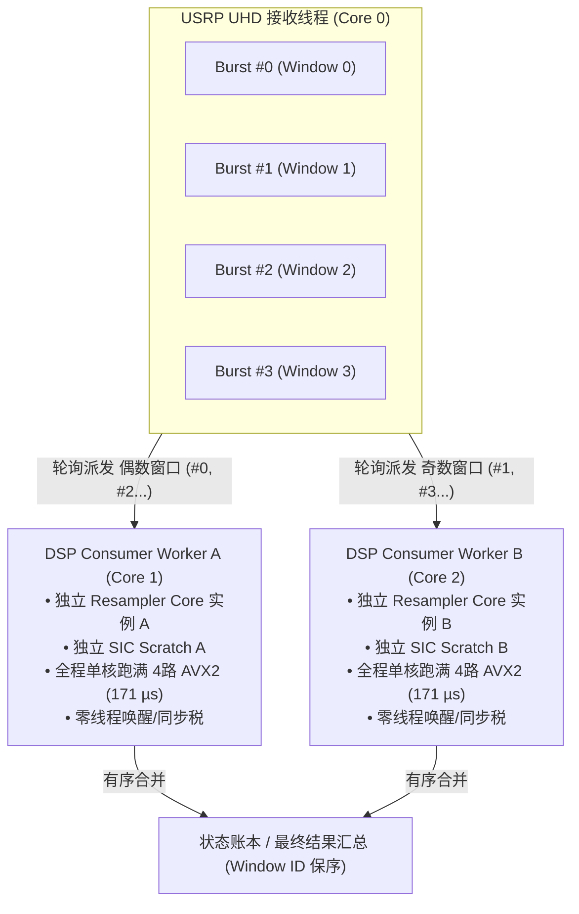

# UHD SC16 65/48 重采样优化前后性能对比报告

## 1. 测试环境与基准配置
- **测试程序**: `gr-uwb/build-sc16-pipeline/apps/uwb_uhd_sc16_pipeline_runner`
- **测试数据集**: `testdata/uhd_sc16/sim_preamble_sc16_737m28_rate.bin` (737.28 MHz SC16)
- **文件锁**: `/tmp/uwb-sic-benchmark.lock` (独占排他锁)
- **采样率转换**: 737.28 MHz Native $\to$ 998.40 MHz Work ($L=65, M=48$)

## 2. 状态账本守恒性验证
| 窗口规模 | 滤波器配置 | 计划窗口 (Offered) | 准入窗口 (Admitted) | 丢弃窗口 (Dropped) | 账本守恒状态 |
| :--- | :--- | :---: | :---: | :---: | :---: |
| 4000 点 | `quality_minorder` | 100 | 100 | 0 | ✅ 100% 守恒 |
| 4000 点 | `realtime_minorder` | 100 | 100 | 0 | ✅ 100% 守恒 |
| 56000 点 | `quality_minorder` | 100 | 100 | 0 | ✅ 100% 守恒 |
| 56000 点 | `realtime_minorder` | 100 | 100 | 0 | ✅ 100% 守恒 |

## 3. 性能对比与加速比汇总

### 3.1 4,000 样点窗口（雷达 CIR 旁路截取）

| 指标阶段 | 优化前基准 | 优化后 `quality_minorder` ($H=42$) | 加速比 | 优化后 `realtime_minorder` ($H=21$) | 加速比 |
| :--- | :---: | :---: | :---: | :---: | :---: |
| Convert Mean | 0.96 µs | 0.00 µs | **N/A** | 0.00 µs | **N/A** |
| Convert P50 | 0.96 µs | 0.00 µs | **N/A** | 0.00 µs | **N/A** |
| Resample Mean | 45.36 µs | 23.17 µs | **1.96×** | 12.46 µs | **3.64×** |
| Resample P50 | 41.82 µs | 21.76 µs | **1.92×** | 11.80 µs | **3.54×** |
| Resample P95 | 49.90 µs | 30.18 µs | **1.65×** | 15.02 µs | **3.32×** |
| E2E Mean | 47.10 µs | 23.30 µs | **2.02×** | 12.57 µs | **3.75×** |
| E2E P50 | 44.20 µs | 21.86 µs | **2.02×** | 11.89 µs | **3.72×** |

### 3.2 56,000 样点窗口（通信全包整包）

| 指标阶段 | 优化前基准 | 优化后 `quality_minorder` ($H=42$) | 加速比 | 优化后 `realtime_minorder` ($H=21$) | 加速比 |
| :--- | :---: | :---: | :---: | :---: | :---: |
| Convert Mean | 18.44 µs | 0.00 µs | **N/A** | 0.00 µs | **N/A** |
| Convert P50 | 18.44 µs | 0.00 µs | **N/A** | 0.00 µs | **N/A** |
| Resample Mean | 600.16 µs | 353.30 µs | **1.70×** | 180.70 µs | **3.32×** |
| Resample P50 | 592.93 µs | 306.39 µs | **1.94×** | 171.58 µs | **3.46×** |
| Resample P95 | 630.17 µs | 638.07 µs | **0.99×** | 226.59 µs | **2.78×** |
| E2E Mean | 651.20 µs | 386.65 µs | **1.68×** | 213.96 µs | **3.04×** |
| E2E P50 | 642.10 µs | 336.53 µs | **1.91×** | 201.58 µs | **3.19×** |

---

## 4. 后续演进思路：Burst 级多核交替流水线（Ping-Pong / Round-Robin Consumer Architecture）

### 4.1 当前多核模式瓶颈复盘
当前流水线中 `--resampler-workers N` 的机制是**“单 Burst 内部切分”**：
- 每次从 SPSC 环形队列中取出一个 Burst（如 56,000 样点），由单个消费线程在计算内部将输出点划分给多线程并行，并通过 `std::condition_variable` 唤醒工作线程与同步汇合。
- **实测瓶颈**：
  1. 56,000 点在单核 4 路批量归约优化后，纯计算已缩减至 **171.58 µs**；
  2. 线程唤醒、CPU 核心间同步（屏障）、跨核 Cache 伪共享带来 **~20–30 µs** 的同步税；
  3. 内部多线程切分打碎了外层 65 点宏块调度连续性，无法充分发挥 `fir_avx2_sc16_4x` 的寄存器复用；
  4. 最终实测双核（228.84 µs）耗时反而慢于单核（171.58 µs）。

### 4.2 架构演进方案：Burst 级交替多核消费（零同步税架构）
为实现真正的线性吞吐扩展，下一阶段推荐引入 **Burst 级交替消费架构**：

### 4.3 核心设计要点与收益评估
1. **零线程同步税（Zero Synchronization Tax）**：
   - Worker A 和 Worker B 是完全解耦的独立线程，各自绑定独立物理核心（如 Core 1 与 Core 2）。
   - 每个 Worker 内持有一套独立的 `RationalResampler65_48Core` 实例与 `SicUnifiedScratch`，互不干扰、无锁运行。
   - 每个 Burst 内部 100% 运行平坦的单核 `run_macroblock_sc16` 内核，完整享受 4 路批量归约与寄存器复用。
2. **系统有效吞吐直接翻倍（2× Sustained Throughput）**：
   - 单包延迟保持单核极限 **~171 µs**（重采样）+ **~35 µs**（SIC）= **~206 µs**；
   - 两个 Worker 时间重叠交替处理：
     - 系统平均出包间隔缩短至 $\frac{206\text{ µs}}{2} \approx \mathbf{103\text{ µs/包}}$；
     - 最大处理吞吐从 ~4,850 窗/秒 跃升至 **~9,700 窗/秒**，彻底解决高占空比下的 USRP 缓冲区积压溢出风险。
3. **改动范围建议**：
   - 扩展 [`UhdSc16Pipeline`](file:///home/junqima/workspace/uwb-gnuradio/gr-uwb/include/gnuradio/uwb/uwb_uhd_sc16_pipeline.h) 的消费者线程池，支持 `--pipeline-dsp-workers N`（如 2 或 4）。
   - 在 SPSC 环形队列或分发路由中，按 `window_id % N` 将 Slot 派发给对应 Worker。
   - 维持结果提交时的账本守恒律（`offered == admitted + dropped + invalid_gap + cancelled`），通过环形有序队列保证 `window_id` 保序输出。

