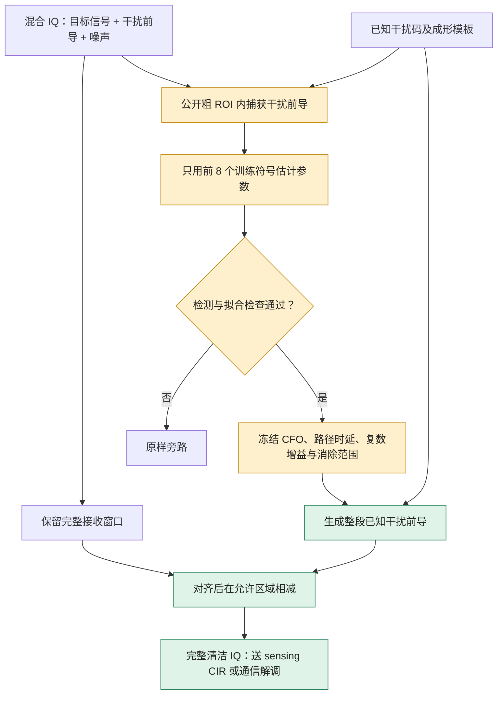
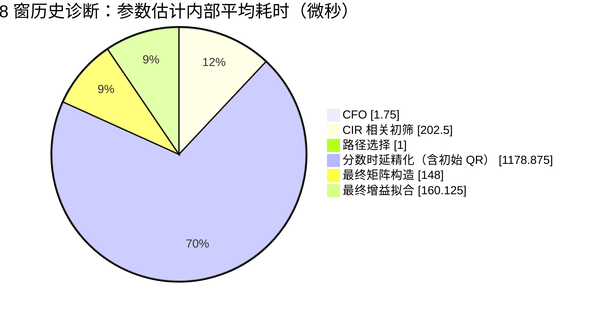
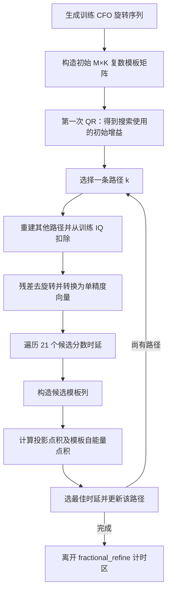
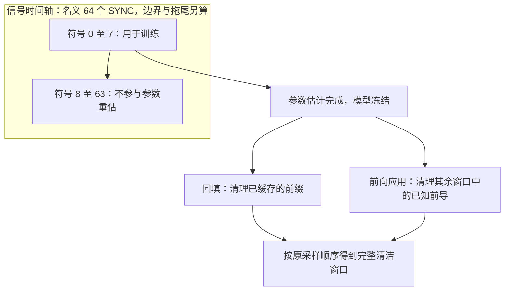
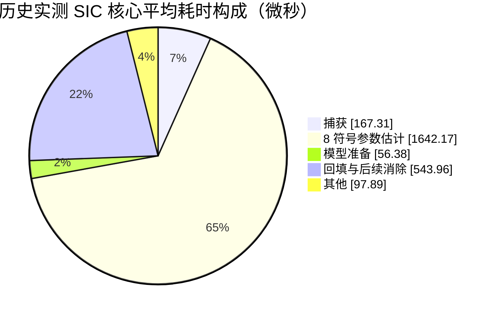

# UWB SIC：八符号估计与全前导消除

> [!summary] 一句话理解
> **前 8 个符号用于“辨认干扰经过了什么信道”，随后用这个固定信道生成整段已知前导，再从接收 IQ 中减掉。**
>
> 当前主要成本是寻找时延与拟合复数路径增益，而不是减法本身。历史正式计时中，8 符号参数估计约 **1.64 ms**，回填和后续消除约 **0.54 ms**，SIC 核心总计约 **2.51 ms/窗**。

关联笔记：[[UWB前导SIC研究进展_方法与双向消除效果_2026-10-18]]。

本文依据集成基线 `794056cd16aa81a8ed94e9cf5100b96ce54ff12e`，tag：`sic-s2-ab-integrated-20261018`。流程图是原理示意，不是实测波形；复杂度是从实现推导的数量级，不是处理器指令数。

## 1. 先分清三个长度

| 符号 | 含义 | 当前典型配置 |
|---|---|---|
| $L$ | 一个干扰 SYNC/Ipatov 符号的工作采样点数 | 1016 |
| $R$ | 用于训练的重复符号数 | 8 |
| $M=RL$ | 完整训练窗口样点数 | 8128；被可见前缀裁剪时更少 |
| $S$ | 名义前导 SYNC 数 | 64 |
| $N_p$ | 实际重建区长度，含允许的边界/拖尾 | 约 $SL$，但不能忽略拖尾 |
| $N_w$ | 输入完整 IQ 窗长度 | 随 A/B 场景变化，通常大于前导 |
| $K$ | 实际选中的路径数 | 当前常用配置上限 4，不保证每窗都选满 |
| $Q$ | 每条路径分数时延候选数 | 21 |

采样率 $F_s=998.4\ \mathrm{MS/s}$ 时，8 个符号约 **8.14 μs**，64 个符号约 **65.13 μs**，都不含额外保护/拖尾。

> [!warning] 信号时长 ≠ 计算耗时
> “观察前 8 个符号”只说明算法依赖多长的输入数据。当前 CPU 仍需要毫秒级处理这些数据；它不是 8 μs 后就能实时输出结果的硬件流水线。

## 2. 全局流程：先估计，再冻结，再消除

两种方向共用这个核心：A 估计并消除通信前导，保留 sensing；B 估计并消除 sensing 前导，保留通信 payload。**不要求解码干扰包的 payload/FCS。**

## 3. 前 8 符号究竟估计什么？

### 3.1 接收模型

设目标信号为 $s[n]$，噪声为 $w[n]$，已知干扰前导模板为 $p[n]$：

$$
y[n]=s[n]+w[n]+e^{j\omega(n-n_0)}\sum_{k=1}^{K}h_k\,p[n-\tau_k],
\qquad \omega=\frac{2\pi\Delta f}{F_s}.
$$

- $\tau_k$：第 $k$ 条路径的时延，可以包含分数采样偏移。
- $h_k$：该路径的复数增益，同时包含幅度和参考相位。
- $\Delta f$：干扰信号相对接收机的 CFO。
- $n_0$：统一相位参考样点；不能随处理分块任意改变。

这里采用“多个静态路径共享一个 CFO”的模型，没有在后续消除中跟踪 SFO 或时变信道。

### 3.2 实际处理顺序

**① 捕获与 CFO。** 在公开粗 ROI 内用干扰码模板相关，定位重复前导。相邻重复符号相关峰的相位差提供 CFO：

$$
\widehat{\Delta f}\approx\frac{F_s}{2\pi L}
\arg\left(\sum_{r\in\mathcal V}
\frac{c_{r+1}c_r^*}{|c_{r+1}c_r^*|}\right).
$$

$\mathcal V$ 只包含实现中通过门槛的有效训练相邻对；不能读取后续符号帮助估计。这个相位差模型也存在相位模糊和误差，不能等同于已知注入 CFO。

**② 从 CIR 选择路径。** 对候选延迟做相关，寻找局部峰，并按强度和路径间距规则选择至多 $K$ 条路径。当前 CIR 初筛是在训练可见范围内，对各延迟位置计算一个符号长的相关；**不是对每个延迟都完整累加 8 个符号。**

**③ 拟合复数增益。** 给定时延与 CFO，在训练窗口构造 $M\times K$ 矩阵：

$$
A_{m,k}=p[n_m-\widehat\tau_k]e^{j\widehat\omega(n_m-n_0)},
\qquad
\widehat{\mathbf h}=\arg\min_{\mathbf h}\|\mathbf y_{\rm train}-A\mathbf h\|_2^2.
$$

实现使用 **Householder QR**，并通过小矩阵 $R$ 的奇异值评估条件数，不直接求 $(A^HA)^{-1}$。

**④ 精化分数时延。** 对路径 $k$，先从训练 IQ 中扣除其他路径的当前贡献，得到残差 $r_k$；再尝试 $\delta=-0.5,-0.45,\ldots,0.5$，最大化归一化投影分数：

$$
J_k(\delta)=\frac{|a_k(\widehat\tau_k+\delta)^H r_k|^2}
{\|a_k(\widehat\tau_k+\delta)\|_2^2}.
$$

候选模板采用预计算多相表与相邻相位插值，不是每个候选样点都重新做长 sinc 滤波。候选投影已经使用 VOLK 向量运算。

**⑤ 再拟合并冻结。** 时延改变后，重新构造矩阵并求最终路径增益。因此当前有两次 QR：一次为时延搜索提供初始增益，一次用于精化后的最终模型。它们不是简单的重复调用，不能随便删掉。

> [!note] 为什么强干扰也不是估计得完全准确？
> 训练 IQ 中仍含目标信号和噪声。在固定、正确的基矩阵下，$\widehat h=h+A^\dagger(s+w)$，目标信号可能污染干扰参数。该关系只能解释固定基下的估计偏差；实际时延、路径选择及 CFO 也会变化。因此训练拟合残差小，不等于目标保护好，更不等于干扰被完全消除。

### 3.3 逐步骤开销：真正的大头是分数时延精化

这里需要区分两个“CIR 估计”：广义上是估计完整干扰信道模型，包含 CFO、路径时延及复数增益；代码中的 `cir_us` 则仅是**用于选路径的相关 CIR 初筛**。前面约 1.64 ms 的大头指广义参数估计，不是单独的 CIR 相关。

正式 3 万窗性能汇总保留了 `estimate8` 总项，没有给出以下全部子项的独立统计。本次从历史 `s1_smoke_final/stage_times.csv` 提取了 **`scope=sic` 的 8 窗记录**，作为内部耗时诊断。不能混入同名的 `scope=demod` 计时，否则会把下游解调的 CFO/CIR 算到 SIC 头上。

| 顺序 | 步骤 / 原始计时字段 | 平均耗时（μs） | 占本组 estimate8 | 包含什么 |
|---|---|---:|---:|---|
| 1 | CFO：`cfo` | 1.750 | 0.10% | 有效重复峰的相位差、归一化与求角度 |
| 2 | CIR 初筛：`cir` | 202.500 | 11.97% | 各延迟格的符号长复数相关 |
| 3 | 路径选择：`path_select` | 1.000 | 0.06% | 局部峰、排序、路径间距约束 |
| 4 | 分数时延精化：`fractional_refine` | **1178.875** | **69.66%** | **初始矩阵与 QR + 残差构造 + 候选时延搜索** |
| 5 | 最终矩阵构造：`matrix_build` | 148.000 | 8.75% | 精化后各路径模板列、相位旋转、复制右端向量 |
| 6 | 最终增益拟合：`gain_fit` | 160.125 | 9.46% | 有限性扫描、Householder QR、求解与条件数检查 |
| — | **以上六项合计** | **1692.250** | **100%** | 本组 estimate8，不包含捕获、模型残差准备和后续应用 |

**本组数据的适用范围：** work-grid、ISR=10 dB、注入 CFO=0、窗口 157376 点、配置 `k_paths=4`、`post_tail=100`，共 8 窗。来源 run 为 `main-work-20261017T123845Z`；manifest 记录 `git_head=7fc4a029…`、dirty patch SHA256 `d6732b6c75bd65bb6d452b7e0e4efae0c5a9093a45f3825cfc2f5f10ae543774`，加载库 SHA256 为 `e93378d2…`（全文见 §6）。配置路径数不代表所有窗口都实际选满 4 条路径。

这组内部六项合计为 **1.692 ms**，整核心平均为 **2.668 ms**；§6 正式性能记录对应 **1.642 ms / 2.508 ms**。它们来自不同 run，不拼接成一张统一的计时账单。8 窗只适合定位热点，不能支持稳定 P99 或通用性能结论。

### 3.4 1.179 ms 的分数时延精化内部，又做了哪些工作？

当前 `fractional_refine` 的计时边界覆盖下面整个框，不只是搜索循环：

以 $M=8128$、$K=4$、$Q=21$ 的完整训练窗口说明工作规模；以下是代码推导，不是子阶段的独立实测：

| 精化内的子工作 | 数量级 | 典型规模与成本来源 |
|---|---|---|
| CFO 旋转、初始矩阵和右端向量 | $O(M+MK)$ | 生成 8128 点旋转序列，构造 32512 个复数矩阵元素 |
| 第一次 QR 与求解 | $O(MK^2)$ | 在 8128×4 的高瘦矩阵上做 Householder 运算；$MK^2=130048$ 只是规模参数，不是精确复乘次数 |
| 每条路径的其他路径贡献 | $O(K(K-1)M)$ | 当前会重建 12 个其他路径模板列，共 97536 个样点，并缩放、扣除 |
| 残差初始化、去旋转与类型转换 | $O(KM)$ | 每条路径重扫训练窗口；涉及双精度中间量与单精度候选投影向量 |
| 候选模板构造 | $O(QKM)$ | 84 个候选列，682752 个样点的查表/插值与写入 |
| 候选投影与自能量 | $O(2QKM)$ | 两次点积，合计 1365504 个复数点积项；已使用 VOLK |
| 更新最佳候选 | $O(QK)$ | 84 次分数比较，通常不是主要成本 |

**目前无法从归档中把 1178.875 μs 进一步准确分配给这些子工作。** 初始 QR 和搜索共享一个计时字段；不能说“21 点搜索独占了 70%”，也不能用最终 QR 的 160.125 μs 直接当作第一次 QR 的实测值：后者不包含同样的条件数检查，矩阵也不同。

### 3.5 其他步骤为什么有这些开销？

- **CFO 约 1.75 μs：** 相位差阶段复用了捕获时算好的重复相关峰，因此这里很便宜。计算这些峰的成本在 acquisition 中；不意味着从原始 IQ 估计 CFO 的全过程只需 1.75 μs。
- **CIR 约 202.5 μs：** 默认延迟格为 $[-4,104)$，即 108 格，最多约 $108\times1016=109728$ 个复数相关项。当前此处是双精度累加的标量循环，而不是候选搜索使用的 VOLK 点积，存在向量化评估空间，但要保留精度和路径选择稳定性。
- **选路径约 1 μs：** 候选规模小，尽管排序实现有二次复杂度，当前不是优先优化对象。
- **最终建矩阵约 148 μs：** 使用精化后的时延重新构造模板是必要的；但同 CFO、同参考点下的旋转序列可以研究复用。不能把前一次 QR 已经原地改写的矩阵直接当作原始模板矩阵使用。
- **最终拟合约 160 μs：** 求解的是高瘦矩阵，$K$ 很小，但 $M$ 有 8128 行。Householder 运算反复读取训练列，条件数检查只针对小矩阵 $R$。不能仅凭“大矩阵”就认定需要通用大型矩阵求逆。
- **模型准备另计：** 冻结参数后，还会重构训练区并计算归一化残差；这属于 `model_prepare`，不在上面六项中。冻结字段复制、门槛判断和外围处理还可能出现在父级计时的其余部分。

### 3.6 针对这部分，下一步如何测、如何优化？

优先把 `fractional_refine` 再拆为“初始矩阵/QR、其他路径残差、候选列构造、候选评分”。诊断时可以批量计时或用采样 profiler，避免对每个短点积都调用时钟而显著改变热点。正式计时仍保留原父字段语义，不能父子相加。

每窗还应记录实际 $K$、$M$、候选数量和成功/旁路/失败状态，以区分“算法更快”与“少选了路径/提前退出”。先按原搜索网格做等价复用，再考虑改变搜索策略。

对本组 **estimate8** 做纯预算推算：

- 仅让 CIR 初筛快一倍：约 $1.692-0.203/2=1.591$ ms，约 **1.06 倍**加速。
- 让整个 fractional_refine 快一倍：约 $1.692-1.179/2=1.103$ ms，约 **1.53 倍**加速。
- 即使整个 fractional_refine 免费，其余五项仍约 **0.513 ms**；这还没算捕获、模型准备和全前导应用。

因此当前合理顺序是：**先查清并削减精化内部重复工作，再优化矩阵/QR 和 CIR；不是只优化 CIR 相关，也不是先删安全检查。** 上述是理论预算，不是已经实现的加速。

## 4. 回填和后续消除：同一个模型，用在不同时间位置

“回填”不是重新估计过去的符号，而是对之前缓存的 IQ 补做一次相减。训练用过的前导也可以消除，但不能把训练区效果当成独立泛化证据。

当前 adapter 以声明的可见前缀终点切分 backfill/forward。因此**回填长度不必正好等于 8128 点**：窗口前面可能还有其他 IQ，且可见前缀可能带保护样点；消除掩码之外仍保持原样。上图是信号语义图，不是每个 PDU 的精确切分坐标。

对允许消除区域 $\Omega$：

$$
\widehat i[n]=e^{j\widehat\omega(n-n_0)}
\sum_{k=1}^{K}\widehat h_k p[n-\widehat\tau_k],
\qquad
y_{\rm clean}[n]=
\begin{cases}
y[n]-\widehat i[n], & n\in\Omega,\\
y[n], & n\notin\Omega.
\end{cases}
$$

其中 $\Omega$ 由公开的名义前导长度、拖尾、允许消除 ROI 和窗口边界共同确定，**不是注入真值给出的精确干扰支持区**。

模型只读；不重新拟合增益、不重新估计 CFO、不用后续解调结果反馈。多径合成、相位旋转、相减构成主要循环。实现还使用固定绝对位置的重建块，保证改变调用分块方式时仍有一致的样点输出。

> [!warning] 冻结模型的代价
> 若 CFO 估计误差为 $\epsilon_f$，经过时间 $t$ 后相位误差约为 $2\pi\epsilon_f t$。所以模型虽然可以外推到后 56 个符号，效果却不保证一直不变。更长前导不仅增加处理量，也更考验 CFO 和信道稳定性。

当前处理的是已收到的完整 PDU。接口可以表达“估计后分段应用”，但这不证明已经实现连续 1 GS/s 的因果实时流水线。

## 5. 复杂度：为什么 8 个符号反而比 64 个符号贵？

另定义 $C$ 为实际评估的捕获相关位置数（含重复确认），$D$ 为 CIR 延迟格数，$P$ 为候选峰数，$N_v$ 为能量前缀扫描长度。以下按模板查表每样点常数成本计：

| 阶段 | 当前实现的主要时间复杂度 | 解释 |
|---|---|---|
| 捕获与能量扫描 | $O(CL+N_v)$ | 不是全窗口每点做长相关，但前缀扫描仍有成本 |
| CFO 相位差 | $O(R)$ | 复用已计算的重复相关峰，不含相关本身 |
| CIR 初筛 | $O(DL)$ | 每个延迟位置一段符号长相关 |
| 峰选择 | $O(D+P^2)$ | 当前候选峰排序为二次循环，实际规模较小 |
| 矩阵构造 | $O(MK)$ | 每条路径产生训练模板列 |
| QR 增益拟合 | 每次 $O(MK^2)$ | 当前精化前后各一次；条件数检查另有小矩阵成本，典型为 $O(K^3)$ 量级 |
| 时延精化，不含其初始 QR | $O(QKM+K^2M)$ | 候选投影，以及为各路径重建其他路径贡献 |
| 训练模型残差检查 | $O(MK)$ | 在训练区重构并计算拟合残差 |
| 全前导应用 | $O(KN_p+N_w)$ | 重建与相减，外加整窗复制/诊断初始化 |

核心主项可概括为：

$$
T_{\rm estimate}=O(CL+N_v+DL+P^2+MK^2+QKM),
$$
$$
T_{\rm apply}=O(KN_p+N_w).
$$

这隐藏了两次 QR、两次候选点积、数据类型转换等常数，不用于直接预测毫秒数。大量小分块调用若反复重建同一个固定块，还会引入额外重复工作；上式对应当前少量分段应用的主要量级。

### 一个直观的工作量对照

按 $M=8128$、$K=4$、$Q=21$：

- 时延精化最多形成 **84 个候选列**。
- 候选模板构造共访问约 $84\times8128=682752$ 个候选样点。
- 每个候选做投影和自能量两次点积，约 **1365504 个复数点积项**。
- 单次 64 符号多径合成的基本路径样点规模为 $4\times65024=260096$，还未计拖尾和相位旋转。

这些操作的单项成本不同，不能据此宣称精确加速比；但它说明了为什么“训练只有 8 个符号”不代表计算很少：**训练数据被反复搜索和拟合，而应用阶段只代入一个已经确定的答案。**

### 内存复杂度

主要包括训练矩阵 $O(MK)$、训练/残差向量 $O(M)$、完整输出与可选重构诊断 $O(N_w)$、固定块 scratch，以及预计算多相模板 $O(HN_p)$，$H$ 为相位表规模。热路径采用预分配；减少动态分配并不意味着没有内存带宽或缓存成本。

## 6. 已有实测：估计占大头，不能只优化相减

下表引用 S1 `s1_perf_core_final/core_cir_summary.json` 的正式记录：每 run 10000 窗、3 轮，200 warmup、64 个真实 code9/code10 输入。**本笔记未重跑性能测试。**

| SIC 核心阶段 | 平均时间 | 约占比 |
|---|---:|---:|
| acquisition | 0.167 ms | 6.7% |
| estimate8 | 1.642 ms | 65.5% |
| model_prepare | 0.056 ms | 2.2% |
| backfill + forward apply | 0.544 ms | 21.7% |
| 其余核心开销 | 0.098 ms | 3.9% |
| **core_total** | **2.508 ms** | **100%** |

不要再把 `train_total` 加到上述子项上：它是父级计时。外层 benchmark 的 SIC 时间约 2.511 ms，与内部 `core_total` 存在小幅计时边界差异。

该记录绑定历史 `7fc4a02` 工作树及报告中记录的 dirty patch，加载库 SHA256 为 `e93378d21390a1e1529a6ef18691f5ccf7922f22a51409e0676e3adfb803fc60`，不是一次新采集的集成 tag 性能结果。当前共享核心未因 A/B 集成改变，但不同窗口、路径数、机器负载仍须重新绑定测量。

历史 core→CIR 配置中，`estimate8` P99 为 **3.917 ms**，`apply` P99 为 **2.107 ms**。不同阶段 P99 不可相加得到总 P99；这些结果也说明只报告均值不够。

## 7. 如何加速：先避免重复工作，再改变算法结构

| 优先级 | 候选优化 | 必须保留/验证的约束 |
|---|---|---|
| 1 | 将 §3.3 的小样本分项诊断扩展到正式性能样本，并细分 fractional_refine 内部 | 已知该小样本中精化约占 70%，但初始 QR 与候选搜索尚未分开测量 |
| 2 | 缓存未变化路径模板、增量更新残差、复用 CFO 旋转 | 路径时延按顺序更新，不能误用旧模板 |
| 2 | 复用几何相同的候选模板能量，减少构造和内存遍历 | 裁剪范围、分数时延、模板边界必须进入缓存条件 |
| 3 | 减少整窗重复复制、复用跨分块重建结果 | 保留失败原样旁路、掩码外不变和分块一致性 |
| 4 | 前导内部预合成一个周期并重复使用，再施加 CFO 相位 | 首尾、拖尾和分数时延单独处理，不当作无限周期 |
| 4 | 研究训练重复结构折叠或粗细两级时延搜索 | 属于算法结构变化，必须重新检查效果和数值稳定性 |

相关/候选点积及部分重建已经使用 VOLK，且模板已经多相预计算。因此“加 SIMD”不是全新的空白机会；更重要的是减少总工作量。现阶段也不建议为了速度随意减少训练符号、路径数或移除条件数检查。

**仅作预算推算：**

- 即使 apply 免费，核心仍约 $2.508-0.544=1.964$ ms，最高约 **1.28 倍**加速。
- 若 estimate8 减半、其余不变，核心约 **1.687 ms**，约 **1.49 倍**加速。
- 达到 0.5 ms 需要整体约 **5 倍**加速，不能由这些局部机会直接保证。

整条 GNU Radio 链路还包含 CIR/解调、PDU 构造与复制、队列等待。历史记录中下游 CIR/解调约 2.4–2.8 ms；SIC 更快不自动代表整链路 P99 或 200 窗/s 达标。

## 8. 三个常见问题

**前导从 64 个符号变成 128 个，会慢一倍吗？**

若训练仍为 8 个符号、路径数与搜索范围不变，估计部分大致不变，重建部分随前导长度增长；总耗时不必翻倍。若一个符号本身的采样长度 $L$ 变长，则训练矩阵和相关也变长，会同时影响估计和应用。

**后面 56 个符号为什么不继续估计？**

当前目标是早期估计后冻结，避免对整段反复搜索，并保留独立评价区。利用后续数据更新模型可以另做算法实验，但会改变时延、计算量和评价独立性，不是当前默认实现。

**这适合 FPGA 吗？**

固定模型的延迟模板读取、复数乘加、相位累加和相减具有规则的数据流，适合研究流水线。参数估计包含搜索、路径选择、QR 和数值判据，更复杂。CPU 的毫秒结果不能直接换算成 FPGA 时钟周期；定点精度、资源、存储带宽和时序都需要独立设计验证。

## 9. 实验组织与证据入口

后续性能开发建议从 `sic-s2-ab-integrated-20261018` 新开 `feature/sic-perf`，A/B 原分支保留作历史对照。每次优化同时检查 A 的 CIR/弱目标保护与 B 的 payload/PER/损伤计数，并报告同输入、同环境下 mean/P95/P99、失败路径和端到端吞吐。正式 benchmark 串行，独占 `/tmp/uwb-sic-benchmark.lock`。

仓库根目录：`/home/junqima/workspace/uwb-gnuradio`。主要证据文件：

- `gr-uwb/lib/uwb_preamble_sic_core.cc`：捕获、CFO、CIR、分数时延精化、QR、冻结模型及分块重建。
- `gr-uwb/lib/uwb_preamble_sic.cc`：完整 PDU 的回填/前向应用、细分计时和输出。
- `docs/sic/S1_八符号模型API.md`：训练/可见/消除/评价四种范围和冻结契约；其中早期默认行为以当前代码与报告为准。
- `docs/sic/S1_八符号估计与全前导消除开发报告.md` §11：历史正式性能及 provenance。
- `gr-uwb/build-sic/sic-results/s1_perf_core_final/core_cir_summary.json`：上述核心耗时原始汇总，属于本地归档而非通用可移植路径。
- `gr-uwb/build-sic/sic-results/s1_smoke_final/{stage_times.csv,summary.json,run_manifest.json}`：§3.3 的 8 窗内部计时、场景与版本来源。CSV 只筛选 `scope=sic`，六个估计子项均有 8 条记录；不要混合解调同名阶段。
- `docs/sic/S2_AB集成验收报告_2026-10-18.md`：当前集成验收范围。

> [!important] 结论边界
> 本文解释已经实现的方法，并分析加速机会；不宣称已经完成优化、MATLAB/native 验证、FPGA 实现或连续 1 GS/s 实时处理。图表中的历史计时也不是当前 A/B 全部场景的统一性能保证。
