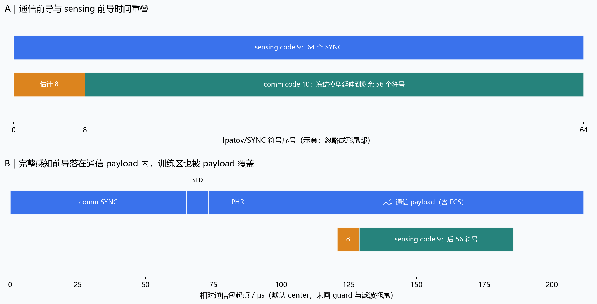
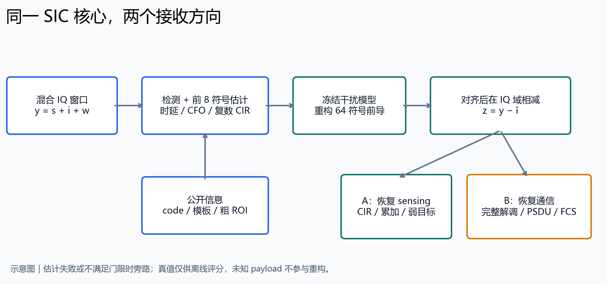
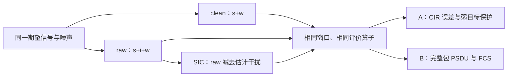
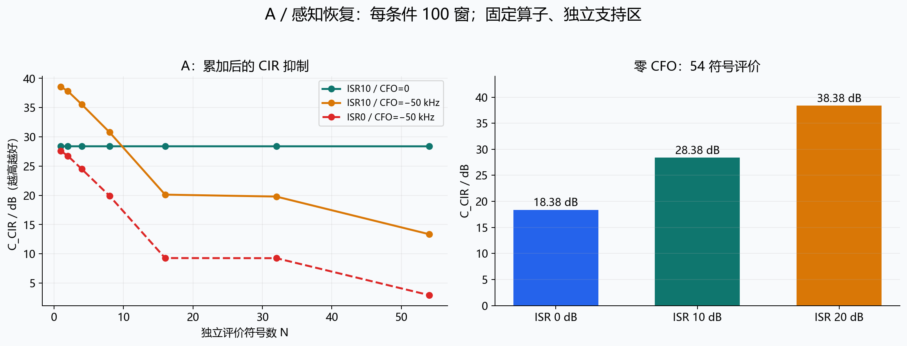
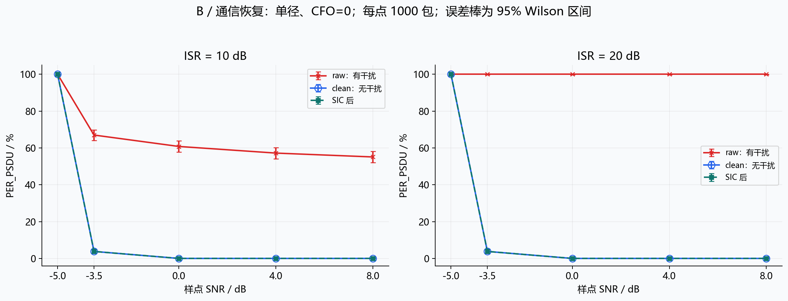

# UWB 前导 SIC：方法与双向消除效果

> [!summary] 目前得到的答案
> **已知前导可以在不解码干扰包的情况下被重构并消除。** 同一个 SIC 核心已经在 GNU Radio 仿真中验证了两个方向：A 恢复 sensing CIR，B 救回被 sensing 前导干扰的通信 payload。
>
> A 的名义 CIR 抑制约 **28.4 dB**，但残余高度相干，累加并未带来预期的额外随机噪声增益。B 在**单径、零 CFO、ISR=20 dB** 的已测条件下，将通信从全错恢复到与无干扰基线相同的错误数。
>
> 算法效果已有证据；当前 host SIC 诊断计时约 **3.1–3.3 ms/窗**，低时延、正式吞吐和 FPGA 实现仍是后续任务。

本文记录截至 **2026-10-18** 的开发事实。A 版本为 `2c383d5`（修复实现 `6619579`），B 为 `ac3849e`。图 3、4 直接读取整改后的归档统计生成；图 1、2 为解释性示意。没有为本文重新运行仿真矩阵。

早期设想见同项目笔记 [[UWB_Ipatov_Preamble_SIC_Obsidian_Plan]]；该笔记保留设计背景，**当前实现范围和实测结果以本文及文末最终开发报告为准**。

## 1. 当前开发任务：同一种方法，解决两个碰撞方向

| 方向 | 想保留的信号 | 要消除的干扰 | 当前观察的效果 |
|---|---|---|---|
| **A：通信 → sensing** | code 9 的 sensing 前导及弱回波 | code 10 的通信前导，preamble-only | CIR 恢复、累加后的残余、弱目标幅度与峰位 |
| **B：sensing → 通信** | code 10 的完整通信包 | code 9 的 sensing 前导，preamble-only | 完整 payload 解调、PSDU/FCS、救回与损伤计数 |

“前导重合”指**时间重叠，使用不同的 preamble code**。B 中 sensing 的全部 64 个 SYNC 都放入通信 payload 内，前 8 个估计符号也与未知 payload 重叠。当前 B 的通信 SYNC/SFD/PHR 没有被干扰，接收链还使用公开调度起点，因此尚未证明任意位置碰撞或完全盲捕获能力。

*图 1：两种实验拓扑。金色表示用于估计的前 8 个干扰符号，绿色表示后续重构区。两部分都可被相减；图中省略了成形尾部和保护区。*

主配置为 `Fs = 998.4 MS/s`，一个 Ipatov/SYNC 符号 **1016 个工作采样点**。因此：

| 对象 | 样点 / 符号 | 对应采样时长 |
|---|---:|---:|
| 一个 SYNC | 1016 点 | 约 1.018 μs |
| 估计区 | 8 个 SYNC，8128 点 | 约 8.14 μs |
| 名义全前导 | 64 个 SYNC，65024 点 | 约 65.13 μs |
| B 默认成形前导模板 | 65064 点，含自然尾部 | 约 65.17 μs |
| B 通信 payload | 116736 点 | 约 116.92 μs |
| B 通信整包 | 211392 点 | 约 211.73 μs |

B 的 wire PSDU 为 **96 B = 94 B 随机数据 + 2 B FCS**；FCS 属于 payload 内容。采样时长与 CPU 处理耗时是不同概念：观察 8.14 μs 的信号，并不意味着软件在 8.14 μs 内算完。

## 2. SIC 到底在做什么

可以把接收到的 IQ 理解成三部分叠加：

$$
y[n]=s[n]+i[n]+w[n].
$$

其中 $s$ 是要保留的信号，$i$ 是已知前导经过信道后的干扰，$w$ 是噪声。已知的是干扰的码和名义波形，未知的是它到达接收机时的**时间、频偏、各条路径幅度与相位**。

SIC 先估计这些未知参数，画出一条尽可能接近真实干扰的复数波形，再从原 IQ 中相减。

*图 2：纯 C++ 数学核心承担检测、估计、重构和相减；GNU Radio PDU adapter 连接窗口、状态和下游消费者。图中流程是当前有界窗口处理的逻辑结构。*

### 2.1 先用 8 个符号估计，再冻结模型

当前方法依次执行：

1. 在公开粗 ROI 内，用干扰码模板确认干扰并估计起点。
2. 利用前 8 个重复符号估计 CFO、CIR、路径时延和复增益；允许的可见前缀与 guard 有明确边界。
3. 选择有限条路径，用复数最小二乘拟合其增益。
4. 将 CFO、时延、复增益和路径集冻结成模型。
5. 按公开的 64-SYNC 长度预测干扰支持区，在允许的相减区域重构整个前导。
6. 输出清理后的完整 IQ 窗口，再运行 sensing CIR 或完整通信解调。

冻结后不再利用后续符号更新模型：当前默认路径没有后段 CFO 重估计、在线 PLL 或 SFO 跟踪。后续符号可用于**离线评分**，不会回流到正式在线结果。

### 2.2 波形重构，而不是删除一个 CIR 峰

设 $p_I$ 为包含成形与有限重复结构的已知前导模板，则重构为：

$$
\hat i[n]=e^{j2\pi\hat f(n-n_0)/F_s}
\sum_{k=1}^{K}\hat h_k\,p_I[n-\hat\tau_k].
$$

$$
z[n]=y[n]-\hat i[n]
=s[n]+w[n]+\underbrace{i[n]-\hat i[n]}_{\text{残余干扰}}.
$$

$\hat h_k$ 必须是**复增益**，同时保留幅度和相位；$\hat\tau_k$ 可以包含分数时延。相位参考 $n_0$ 也属于模型，改变参考时刻时必须同步旋转增益。A-N02 二轮整改修复的正是离线诊断中这一约定被破坏的问题。

直观地说：CIR 描述“干扰沿哪些路径、以多大的复幅度到达”；真正被扣掉的是这些路径共同形成的**时域 IQ 波形**。仅把 CIR 图上的最大峰置零，不能完成这里的 payload 消除。

### 2.3 为什么无需解码干扰的 payload

本轮被消除的对象只有**已知前导**，其内容可以直接生成，因此不要求解码干扰包的 PHR、payload 或 FCS。B 中所需恢复的通信 payload 是未知数据，由相减后的通信解调器正常解码。

当前实现每次估计一个指定码的前导干扰。候选码库的全面盲搜、多干扰源逐次消除、未知 sensing payload 重构，尚未包含在 A/B 的验收结论中。

## 3. 怎么判断“真的消掉了”

每一个测试窗口都保留三路配对结果，共用期望信号、payload 和噪声：

总功率降低并不足以证明成功，因为错误相减也可能损伤期望信号。本文采用以下互补证据：

| 指标 | 回答的问题 | 口径 |
|---|---|---|
| IQ 干扰抑制度 | 重构波形离真实干扰多近？ | $10\log_{10}(\|i\|^2/\|i-\hat i\|^2)$，仅离线评价使用真值 |
| $C_{\rm CIR}$ | CIR 相对 clean 的误差降低多少？ | $10\log_{10}(\|H_{raw}-H_{clean}\|^2/\|H_{sic}-H_{clean}\|^2)$ |
| 目标幅度与峰位 | 弱回波是否一起被消掉？ | 固定目标 ROI，相对 clean 评价 |
| PER_PSDU / PER_FCS | 接收机最终能否恢复通信包？ | 完整包计数，错误和失败均计入分母 |
| rescue / damage | SIC 救回了多少包，又损伤了多少包？ | 同窗 raw 失败→SIC 成功 / raw 成功→SIC 失败 |

**A 的 CIR 抑制度与 B 的 IQ 抑制度不能直接比大小；ISR=20 dB 也不等于“抑制度 20 dB”。** ISR 描述消除之前干扰相对期望信号的强弱。B 的 ISR 在实际重叠区计算，SNR 在通信 payload 参考区计算，均为接收样点能量口径，不是 $E_b/N_0$。

## 4. A 的结果：sensing 恢复了什么

A 完成 12 个主条件 × 100 窗，即 **1200 窗**；另有 **1000 窗旁路**和 **600 窗误差来源实验**。

独立评价区根据相关算子的真实样点支持确定。当前 full CIR ROI 的合法符号集合为 **r=9…62，共 54 个符号**（0-based）。这个数不是把 64 简单减去 8：r=8 的相关支撑会读入训练/guard，r=63 的支撑会超出实际相减区。

*图 3：整改后的 acceptance summary，固定 full CIR ROI，独立符号集合，每条件 100 窗的 dB 均值。左图展示改变累加长度后的真实结果，右图固定 N=54、CFO=0。*

### 4.1 名义条件下，CIR 与弱目标都得到恢复

| 单径条件 | N=54 的 CIR 抑制，约值 |
|---|---:|
| ISR=0 dB，CFO=0 | 18.4 dB |
| ISR=10 dB，CFO=0 | **28.4 dB** |
| ISR=20 dB，CFO=0 | 38.4 dB |
| ISR=10 dB，CFO=±50 kHz | 13.4 dB |
| ISR=0 dB，CFO=±50 kHz | 2.9 dB |

零 CFO 时，抑制度随 ISR 增长并不代表所有绝对残余同时变小。误差分析发现，训练污染造成的部分残余与期望信号相关，其绝对量跨 ISR 近似不变；分母中的残余近似固定，干扰功率增大也会提高抑制度数值。

弱目标保护在 **12 条件 × 21 个评价组合 = 252 个组合**中全部达到原定门槛：幅度误差绝对值 P95≤1 dB，峰位偏移≤1 sample。ISR10/CFO0 名义例中，目标幅度误差由 raw 的约 **1.343 dB** 降至 SIC 的 **0.153 dB**，峰移为 0。这证明该设置下的目标保真性，尚不是硬件测距精度或完整 Pd/Pfa 曲线。

无干扰旁路 **1000/1000 窗逐字节不变**。

### 4.2 为什么累加没有再带来十几 dB

最初的直觉是合理的：如果每个符号的残余 $e_r$ 相互独立、零均值，相干平均后残余功率大致按 $1/N$ 下降，理想增益是 $10\log_{10}N$。

但若残余包含固定成分 $b$：

$$
e_r=b+\epsilon_r,\qquad
\bar e_N=b+\frac{1}{N}\sum_{r=1}^{N}\epsilon_r,
$$

累加只会压低随机项，固定偏差仍然保留。A 的名义结果中，残余相干比例约 **0.9995**；54 符号的额外残余累加收益约 **−0.007 dB**，几乎为零。

> [!important] 这轮 A 的关键发现
> 当前瓶颈主要是**有结构的估计偏差**，而非每个符号独立变化的随机残余。要进一步抑制，必须改善模型与估计，不能只增加 accumulation 长度。

困难 CFO 下，冻结模型的相位误差会沿前导增长。完整旧 56 符号评价中出现的负收益是真实现象；只补减相减区尾部并不能把它消除。合法 54 符号结果较好，涉及评价集合改变，不能被解释为算法已经修复了后段残余。

### 4.3 已定位的残余来源

| 条件 | 主要证据与解释 | 后续可研究方向 |
|---|---|---|
| 零 CFO、整数时延 | sensing 在训练区投影进干扰模板，污染复增益和路径选择；单径还可能被拟合为 3 条路径 | 抑制训练污染、路径数约束、联合/正则化估计 |
| 困难 CFO | 8 符号估计后外推，后段相位偏差放大 | 提升短窗 CFO 精度，评估延迟与更新成本 |
| 分数时延、多径 | 生成器 PCHIP 与核心 polyphase 重构算子不同 | 独立带限生成器交叉验证，后续实测模板 |

离线有限网格搜索在困难 CFO 的固定 4 窗上，将同口径 CIR 残余相对 clean 的归一化能量从中位数 **−31.49 dB** 降至 **−44.10 dB**，配对改善中位数约 **12.61 dB**。这里是残余能量比，越负越好；它不是上表的 $C_{\rm CIR}$。

该搜索利用 clean 评价选择候选，属于离线诊断，尚未转化为在线收益。S6“使用真值参数重构”的结果也只是**失配参考**，不能作为模型族最优下界。有限网格未找到改善，同样不能证明已达到局部最优。

## 5. B 的结果：能否重新解调通信 payload

B 完成 **32 个条件、24200 包**：无干扰闭环 100 包、名义 100 包、SNR/ISR 矩阵 15000 包、位置/CFO/多径 6000 包、三类负样本 3000 包。各条件之间部分随机数有意复用，不能把所有包当成同一条件下的独立样本来合并计算置信区间。

*图 4：单径、CFO=0、前导位于 payload 中部，每点 1000 包。clean 与 SIC 曲线重合。PER 是错误比例，误差棒采用整改后的 95% Wilson 区间；0 错误点仍有非零上界。*

### 5.1 已达到“消除后救回包”的目标

下表数字均为**错误包数 / 总包数**，越小越好：

| 测试条件 | clean | raw | SIC |
|---|---:|---:|---:|
| 名义：ISR10、SNR30、单径、CFO0 | 0/100 | 52/100 | **0/100** |
| ISR10、SNR8、单径、CFO0 | 0/1000 | 551/1000 | **0/1000** |
| ISR20、SNR0、单径、CFO0 | 0/1000 | 1000/1000 | **0/1000** |
| ISR20、SNR4、单径、CFO0 | 0/1000 | 1000/1000 | **0/1000** |
| ISR20、SNR8、单径、CFO0 | 0/1000 | 1000/1000 | **0/1000** |
| ISR20、SNR−3.5、单径、CFO0 | 38/1000 | 1000/1000 | **38/1000** |
| ISR20、SNR−5、单径、CFO0 | 1000/1000 | 1000/1000 | 1000/1000 |

SNR−3.5 dB 时，SIC 救回 962 个 raw 失败包，剩余错误与 clean 的噪声受限结果一致。SNR−5 dB 时 clean 本身已全错，SIC 无法消除这部分噪声限制。

**ISR20 表示重叠区干扰能量是通信信号的 100 倍。** 在这些指定条件下仍能恢复，是当前最直接的通信价值证据。0/1000 对应的 PER 95% Wilson 上界约 **0.383%**，不能写成真实 PER 恒为零。

### 5.2 位置、CFO、多径与误操作

| 扩展条件 | raw 错包 → SIC 错包 | 其他结果 |
|---|---|---|
| payload 前部、ISR10、SNR−3.5 | 357/500 → 20/500 | clean 也是 20/500，救回 337 包 |
| payload 后部、ISR10、SNR−3.5 | 343/500 → 20/500 | clean 也是 20/500，救回 323 包 |
| payload 前部/后部、ISR10、SNR30 | 293/500、281/500 → 均 0/500 | IQ 抑制约 41.33/40.93 dB |
| 正式四径、CFO±50 kHz、ISR10 | 2/500、3/500 → 均 0/500 | IQ 抑制约 22.63/22.64 dB |

全部 12 个位置/困难条件中，`raw 成功 → SIC 失败` 的计数为 **0**。无 sensing、错误 code11、无重叠三类负样本各 1000 窗，误提交消除为 0。

正式四径 profile 的路径时延为 `[0, 7.4, 23, 51.2]` work samples；早期“约 3.64 dB”来自另一套自定义整数四径，不能用来描述当前正式四径结果。

> [!note] 20 dB 目标的边界
> B 已证明**特定单径、零 CFO 条件下容忍 ISR=20 dB**。CFO 与正式四径的扩展验收覆盖到 ISR=10 dB，尚未证明 ISR20 × 多径 × CFO 的组合，也未证明干扰跨越通信前导/PHR 的碰撞。

### 5.3 为什么 B 的表现比 A 更好

从信号结构上看，A 的期望 sensing 前导也是重复信号，它对干扰模板的投影更容易跨符号保持一致；B 的未知随机 payload 提供了不同的训练污染结构。这与 A 中观察到的相干残余、B 中较好的恢复效果相吻合。

这是**基于结构与当前结果的解释**，不是已经完成的严格等条件因果证明。两方向的接收指标和信号几何也不同，不能用“B 的约 40 dB”直接减去“A 的 28.4 dB”宣称算法提升了十几 dB。

## 6. 时间与算力：方法成立后，还需要解决什么

当前代码采用“估计一次，后续循环重构”的结构。若冻结路径数为 $K$，相减样点数为 $N$，直接重构的主要工作量随 $NK$ 增长；模板更长或路径更多，应用模型的工作量也会增加。估计固定使用 8 个符号时，其训练长度并不随 64 的名义前导长度同比增长。

| 阶段 | 现有 B 环境的诊断 mean | 说明 |
|---|---:|---|
| SIC 核心 | 3.106–3.302 ms/窗 | 8 符号估计 + 全前导重构相减 |
| 完整通信解调 | 约 2.9–3.1 ms/窗 | 在 SIC 输出上继续解调，单独计时 |
| 离线生成器 | 约 22 ms/窗 | 仿真生成成本，不属于实际接收在线算法 |
| SIC 原定优化目标 | ≤0.5 ms mean；≤1 ms P99 | **目标，当前未验收达到** |

这些计时来自既有开发报告，不是本文重跑的独占性能实验。SIC 与解调若由同一线程顺序执行，按上述均值粗估约 6 ms/窗，在 200 窗/s 下平均工作负荷就会超过一秒每秒；若分不同流水级，吞吐需按各级瓶颈与排队实测，不能简单相加后判定所有架构都不可行。

重构部分与 FPGA 的流水实现相适应：延迟/模板查表、复乘、路径求和、CFO 相位递推、IQ 相减。真正还需要设计的是前端搜索、CFO/分数时延估计、复数拟合、定点字长、缓存及数据带宽。目前没有 FPGA 综合、资源占用、时序或板上证据，不能将“循环可流水化”写成整个接收机已硬件可行。

## 7. 当前状态与下一轮任务

| 工作项 | 当前状态 |
|---|---|
| S0：不同码前导碰撞与 SIC 基础链路 | 作为现有基础保留；历史 native 结果独立记录 |
| S1：8 符号估计、冻结模型、全前导相减 | 已实现，A/B 共用 |
| S2-A：累加后 CIR、弱目标保护、误差来源 | 已交付；A-N01/A-N02 及二轮问题已复核关闭 |
| S2-B：payload 重叠、完整解调、PER/救回/损伤 | 已交付；B-N01 已复核关闭 |
| native/硬件、MATLAB、本轮正式吞吐 | 尚未完成当前 A/B 对应验收 |

下一轮建议按以下顺序推进；这些是**待安排的开发任务**，不是已经实现的功能：

- [ ] **A：把困难 CFO 的离线改善空间转为在线算法。** 先在原固定样本上验证，再使用独立验收集；同时衡量额外观察长度和处理时间。
- [ ] **A：降低训练区污染。** 对比路径约束、正则化或联合估计，要求 CIR 误差降低且弱目标不受损。
- [ ] **B：验证 ISR20 与 CFO、多径、位置的组合。** 对照同批 clean，保留原始失败与损伤，不只统计成功子集。
- [ ] **B：扩展到通信 SYNC/SFD/PHR 碰撞。** 明确捕获、同步、PHR、payload/FCS 的失败阶段，并评估不依赖公开调度起点的接收流程。
- [ ] **统一仿真与模板口径。** 增加独立带限分数时延生成器，分离生成器失配与算法参数误差；完成 MATLAB 对照。
- [ ] **串行、同环境正式 benchmark。** 分开量化检测、估计、重构、PDU/队列和消费者，验证 200 窗/s、P99、missed admission 与内存。
- [ ] **依据热点制定 FPGA/异构方案。** 先做运算量、定点和带宽预算，再讨论综合与上板。

论文目前可以围绕“已知前导、短窗估计、整段 IQ 消除、双向接收收益”组织证据，并分析碰撞位置与残余来源。关于通信距离，现阶段最稳妥的实测表述是“指定条件下的容忍 ISR 提高到 20 dB”；距离增益还需要链路预算、路径损耗和节点几何，尚无实测依据。

## 8. 复现入口与证据索引

开发仓库位于 WSL：`/home/junqima/workspace/uwb-gnuradio`。两个 worktree 的路径、产物和最终报告如下，适合继续交接给 OpenCode：

| 内容 | A | B |
|---|---|---|
| worktree | `.worktrees/sic-sensing-accum` | `.worktrees/sic-payload-collision` |
| 分支 | `feature/sic-sensing-accum` | `feature/sic-payload-collision` |
| 最终整改报告 | `docs/sic/S2A_整改开发报告_2026-10-18.md` | `docs/sic/S2B_整改开发报告_2026-10-18.md` |
| 主结果 | `gr-uwb/build-sic-accum/results/s2a/acceptance_rectification` | `gr-uwb/build-sic-payload/results/s2b_matrix_rectification` |
| 主校验器 | `tools/sic/verify_s2a.py` | `tools/sic/verify_s2b.py` |
| 诊断补充 | `tools/sic/equal_condition_compare.py` | `tools/sic/s2b_aggregate.py` |

A-N02 最后一次独立复核：24/24 归档基线校验、5/5 相关 C++ 回归通过；故意恢复旧相位参考错误能被拒绝；16 窗有界搜索与报告一致。B-N01 独立复核：修正库路径信任根，32 条件汇总复核通过，负样本与跨 worktree/父目录库冒用均被拒绝。

随本文保存的 `assets/figure_sources.json` 记录了图表输入文件路径、SHA-256、A/B 提交号和绘图数据。`build_figures.py` 是可复现绘图脚本，在仓库的 `docs/sic/obsidian_2026-10-18/` 中执行；Windows 副本用于留档。四幅图同时提供 PNG 与 SVG，本文默认嵌入 PNG，SVG 可用于后续排版。

> [!info] 阅读这些结果时保留的边界
> 当前证据属于 GNU Radio 工作采样网格上的有界窗口仿真。S2-A/B 尚未完成 MATLAB、native、USRP/FPGA、连续 1 GS/s 和统一实时吞吐验收。通信 BER 未实现，本文的通信效果使用完整包 PSDU/FCS/PER；感知效果使用 CIR 与目标保真性。上述限制已包含在后续任务中。
